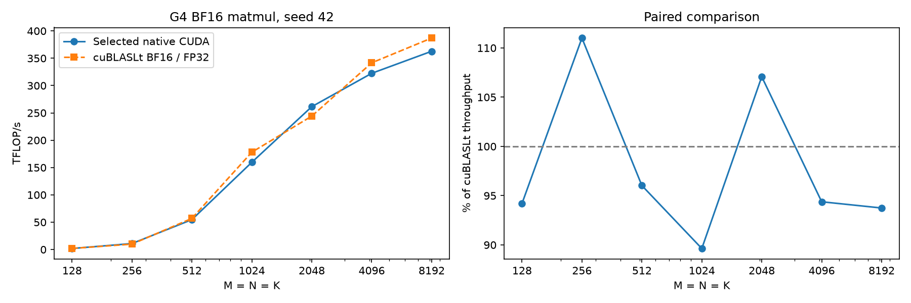
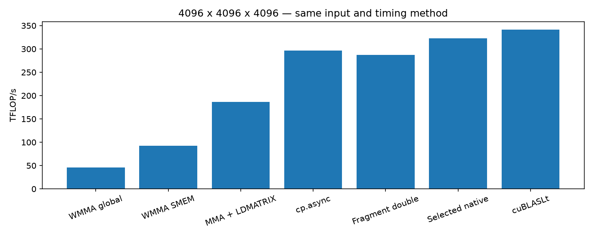

# G4 BF16 matmul: 기초 CUDA에서 타일·파이프라인 최적화까지

`D = A @ B`를 직접 작성한 CUDA C++ 커널로 계산한다. A/B는 BF16 row-major,
D는 FP32이며 Tensor Core 내부 누산도 FP32다. 별도 C 입력, alpha/beta 산술,
bias, activation은 없다. 같은 입출력 타입의 cuBLASLt와 비교한다.

실측 장비는 **NVIDIA RTX PRO 6000 Blackwell Server Edition, SM120, 188 SM,
약 95 GiB**다. CUDA 13.0.88에서 빌드·검증했다.

## 실행

```bash
cd tensor_core_gemm_bf16
make                         # 기본 빌드 타깃 sm_120
make check                   # CPU 주소 검사 + 전체 GPU 정확도 검사
make bench                   # 기초 단계별 128~8192 비교
make best                    # selected.json의 크기별 설정과 cuBLAS 비교

./build/bf16_gemm list        # 설정 이름, 타일, SMEM, 지원 여부
./build/bf16_gemm tune 4096 3 # 모든 후보 탐색, 3회, 기본 seed
BF16_VARIANTS=q128_s2 BF16_GROUP=8 ./build/bf16_gemm tune 4096 5 42
python3 benchmark_selected.py --seed 20261017 --rounds 5 --include-stages
python3 analyze.py results/selected-*.jsonl --output results/summary
```

`bench/tune SIZE ROUNDS SEED`에서 SIZE=0은 128·256·512·1024·2048·4096·8192
전체를 뜻한다. SIMT 기초 단계는 2048까지만 측정한다. 각 후보는 M/N/K가 해당
타일 크기의 배수여야 한다. 조건을 만족하지 않으면 오류를 반환한다.

[실행·저장 결과 분석 노트북](../notebooks/tensor_core_gemm_bf16_g4.ipynb)은 기본적으로
저장된 결과만 읽는다. 노트북의 `RUN_GPU=True`를 선택하면 현재 G4 런타임에서
빌드·검증·재측정한다. Colab 런타임 할당·종료는 노트북이 수행하지 않는다.

## 단계별 구현

| 단계 | 이름 | 개념 |
|---|---|---|
| 0 | `s0_simt` | BF16을 FP32로 읽어 단순 내적 |
| 1 | `s1_wmma_global` | BF16 WMMA, global memory에서 fragment 로드 |
| 2 | `s2_wmma_smem` | 블록·warp 타일과 SMEM 재사용 |
| 3 | `s3_mma_ldmatrix` | 직접 `mma.sync.m16n8k16`, `ldmatrix`, XOR swizzle |
| 4 | `s4_async` | `cp.async` 다단계 입력 파이프라인 |
| 5 | `s5_frag_double` | 한 K 타일 안의 fragment 더블 버퍼링 |
| 6 | `t/f/x/p/q/z/h` 후보 | 타일·복사·MMA 순서·주소 계산·출력·L2 재사용 탐색 |

각 단계는 교육용 실행 경로로 남긴다. 더블 버퍼링처럼 특정 구성에서 느려진 단계도
포함한다. 단계 2→3에는 타일 크기와 fragment 접근 방식이 함께 바뀌므로 차이 전체를
한 가지 기법의 효과로 해석하지 않는다. 자세한 채택·기각 근거는 [WORKLOG.md](WORKLOG.md)에 있다.

- `t`: 타일/BK/stage/warp 모양 탐색. 이름의 `w`는 warp 타일이다.
- `f`: SMEM을 재사용한 coalesced FP32 출력과 복사 배치.
- `x`: 다음 K 타일의 첫 fragment를 마지막 MMA 전에 미리 읽기.
- `p`: 인접 B fragment 두 개를 `ldmatrix.x4.trans` 한 번으로 읽기.
- `q`: 글로벌 복사 포인터를 매 타일 갱신해 반복 주소 계산 줄이기.
- `z`: 큰 타일에서 복사 전/후 발행, raked B 복사, MMA 순회 조합 비교.
- `h`: SMEM fragment 주소를 루프 밖에서 계산하고 modulo 대신 ring index 갱신.

## 정확도와 측정

동일한 **실제 BF16 입력값**을 FP32로 정확히 변환하고, cuBLAS의 pedantic FP32 GEMM을
reference로 사용한다. 원래의 양자화 전 FP32 입력을 reference로 삼지 않는다.
작은 shape에서는 이 reference 자체를 CPU FP64 내적과 비교한다.

GPU 검증은 전체 출력을 비교하며 `max(abs(error))/max(abs(ref)) <= 1e-4`와
`norm(error)/norm(ref) <= 1e-4`를 모두 요구한다. NaN/Inf와 미기록 출력은 실패다.
두 seed, [-1,1] 난수, 0 입력, 부호 상쇄, 음수 입력, 직사각형·짧은 K·ring wrap·
부분 행 그룹 경계를 검사한다. 일반 입력의 모든 BF16 지수 범위를 검증한 것은 아니다.

최종 기본 시간은 여러 matmul을 **CUDA Graph**로 capture한 뒤 CUDA Event로 측정한
연산당 시간이다. warmup, graph 생성, 입력 생성·변환·전송, 할당, 정확도 검사,
cuBLAS 알고리즘 선택은 제외한다. 같은 배열을 반복 재사용하는 resident-input 측정이며,
매 연산마다 새 데이터를 전송하는 end-to-end 시간과는 다르다.

cuBLASLt는 32 MiB workspace와 최대 32개 heuristic 후보를 사용한다(실제 반환 수는
더 적을 수 있다). 선택도 Graph 방식으로 수행하며, 최종 성능과 전체 출력 정확도를
직접 작성한 커널과 같은 조건에서 확인한다. 각 round의 후보 실행 순서를 섞고,
5회 중앙값과 새 seed의 독립 재측정을 저장한다. TFLOP/s는 `2*M*N*K/time`이다.

`BF16_TIMING=event`는 직접 launch한 배치를 Event로 재는 별도 모드다. 작은 행렬에서는
CPU launch 간격이 이 시간에 포함될 수 있다. JSON의 `timing`이 다른 결과를 섞지 않는다.

## 프로파일링

```bash
make profile K=q128_s2 SIZE=4096 GROUP=8
# 저장한 ncu 보고서를 CSV로 추출
ncu --import results/profile-q128_s2-4096.ncu-rep --csv --page raw > results/profile.metrics.csv
python3 profile_summary.py results/*.metrics.csv --output results/profile-summary.json
```

`profile` 모드는 warmup 이후 `cudaProfilerStart/Stop`으로 지정한 실제 matmul만 캡처한다.
프로파일링으로 얻은 실행 시간은 일반 벤치마크 시간과 분리한다. GPU peak 비율을
시간으로 추정한 값과 실제 Tensor 파이프 카운터도 구분한다.

클럭은 `nvidia-smi --lock-gpu-clocks`로 목표 범위를 요청할 수 있으나 전력·온도
제한이 우선한다. 각 실험의 `*.telemetry.csv`에 실제 코어·메모리 클럭, 전력, 온도를
기록한다. 직접 클럭을 바꿨다면 끝난 뒤 `nvidia-smi --reset-gpu-clocks`로 복원한다.

## 이전 A100 실험과의 차이

| 항목 | 이전 단계별 GEMM | 이번 GEMM |
|---|---|---|
| GPU | A100, Ampere, SM80 | RTX PRO 6000 Blackwell, SM120 |
| A/B 저장 | FP32, 원소당 4 byte | BF16, 원소당 2 byte |
| Tensor Core 곱셈 | TF32, 가수 소수부 10 bit | BF16, 가수 소수부 7 bit |
| 내부 누산 / 출력 | FP32 / FP32 | FP32 / FP32 |
| 기본 MMA 명령 | m16n8k8 | m16n8k16 |
| 연산 | alpha AB + beta C | AB |

BF16은 입력 전송량과 같은 타일의 공유 메모리 사용량을 절반으로 줄이지만, 입력의
유효 정밀도는 TF32보다 낮다. 내부 FP32 누산은 합산 오차를 줄이며 입력 반올림을
복구하지 않는다. 여기서 C를 더하는 연산을 제거해도 행렬곱의 K 방향 내부 누산은 필요하다.

타일 재사용, 비동기 복사, fragment 공급이라는 원리는 같지만 최적 타일·warp 배치·
파이프라인 깊이는 다시 탐색했다. 이 구현은 Blackwell에서도 `mma.sync` 경로를 사용하며,
새 아키텍처의 모든 전용 명령을 사용한 구현은 아니다. GPU·dtype·연산이 함께 달라졌으므로
이전 TFLOP/s와의 차이를 GPU 세대 효과 하나로 해석하지 않는다.

## 최종 실측

2026-10-17, 두 seed(42, 20261017), 조건별 5회 중앙값. 아래 표는 seed=42다.
모든 행은 측정 전·후 전체 출력 검사를 통과했다. 각 비율은 같은 실행의 cuBLASLt
시간 / native 시간이며, 1보다 작으면 native가 느리다.

### 코어 클럭 목표 2100 MHz

| N (정사각) | native ms | native TFLOP/s | cuBLAS ms | cuBLAS 대비 성능 |
|---|---:|---:|---:|---:|
| 128 | 0.002279 | 1.84 | 0.002146 | 94.20% |
| 256 | 0.003078 | 10.90 | 0.003417 | 111.00% |
| 512 | 0.004910 | 54.67 | 0.004715 | 96.03% |
| 1024 | 0.013452 | 159.65 | 0.012057 | 89.63% |
| 2048 | 0.065720 | 261.41 | 0.070370 | 107.08% |
| 4096 | 0.426207 | 322.47 | 0.402248 | 94.38% |
| 8192 | 3.030624 | 362.80 | 2.841076 | 93.75% |

### 자동 클럭

| N (정사각) | native ms | native TFLOP/s | cuBLAS ms | cuBLAS 대비 성능 |
|---|---:|---:|---:|---:|
| 128 | 0.002042 | 2.05 | 0.001941 | 95.06% |
| 256 | 0.002752 | 12.19 | 0.003048 | 110.76% |
| 512 | 0.004246 | 63.23 | 0.004081 | 96.11% |
| 1024 | 0.011626 | 184.71 | 0.010376 | 89.25% |
| 2048 | 0.057441 | 299.09 | 0.060771 | 105.80% |
| 4096 | 0.377023 | 364.54 | 0.367970 | 97.60% |
| 8192 | 2.791993 | 393.81 | 2.592156 | 92.84% |

256과 2048에서는 두 seed 모두 cuBLAS보다 빨랐다. 나머지 크기에서는 cuBLAS가
앞섰다. 제어 클럭의 4096·8192는 약 94% 수준이고, 자동 클럭의 4096은 약 98%다.
최종 telemetry의 코어 클럭 표본 범위는 제어 조건 2085~2092 MHz, 자동 조건
1875~2422 MHz였다. 자동 클럭 결과에는 전력·온도에 따른 변동이 포함된다. 두 조건을 합쳐 중앙값을 내지 않는다.

전체 264개 등록 후보의 최종 GPU 비교 **17,736건**, CPU FP64 reference 비교 **24건**,
지원하지 않는 shape 거부 **264건**이 통과했다. CPU 레이아웃 검사 180건과 분석기
단위 검사 5건도 통과했다. 작은 shape 검사에서 정규화 최대 오차는 5.94e-7 이하,
상대 L2 오차는 3.24e-7 이하였다. 이는 같은 BF16 입력에 대한 구현 오차다.

### 프로파일러에서 확인한 차이

2100 MHz 목표의 별도 Nsight 실행이다. 아래 비율은 Tensor pipe elapsed 카운터이며,
위 표의 cuBLAS 대비 성능 비율과 의미가 다르다.

| N | 커널 | Tensor elapsed | 실행 명령 수 | registers/thread |
|---|---|---:|---:|---:|
| 4096 | 초기 cp.async | 73.72% | 173.71M | 126 |
| 4096 | 최종 q128_s2 | 80.11% | 120.82M | 192 |
| 4096 | cuBLASLt | 84.87% | 96.77M | 218 |
| 8192 | 최종 q128_s2 | 89.92% | 961.41M | 192 |
| 8192 | cuBLASLt | 95.88% | 758.28M | 218 |

최종 커널과 cuBLAS의 active-warp occupancy는 약 16%로 비슷했지만, native에는
더 많은 실행 명령과 short/long scoreboard stall이 관측됐다. 선택한 커널은 spill이 0이었다.
이 증거는 남은 명령·의존성 비용을 줄일 여지가 있음을 보여 주며, 시간 차이 전체의
원인을 단정하지 않는다. LDM 전용 bank-conflict 카운터는 수집할 수 없었으므로
CPU 주소 검사만으로 실제 bank conflict가 전혀 없다고 주장하지 않는다.

## 저장 결과와 재현

[고정 목표 클럭 원시 결과](artifacts/2026-10-17-g4/final-fixed/),
[자동 클럭 원시 결과](artifacts/2026-10-17-g4/final-auto/),
[프로파일 요약](artifacts/2026-10-17-g4/profile-summary.json),
[장비 정보](artifacts/2026-10-17-g4/environment.json)를 저장했다.
각 실행의 metadata, 실제 클럭·전력·온도 telemetry와 전체 출력 검사도 함께 있다.

[소스 묶음](artifacts/2026-10-17-g4/source-g4-bf16.tgz)과
[Nsight 원본 보고서](artifacts/2026-10-17-g4/profiles-final/raw-reports.tgz)를 보관했다.
실패한 후보와 이전 소스의 탐색 기록은 `exploratory.tgz`에 따로 보관하며 최종 표에 섞지 않는다.

```bash
python3 analyze.py artifacts/2026-10-17-g4/final-fixed/selected-*.jsonl --output /tmp/bf16-summary
# 권한과 GPU가 지원할 때만 적용. 메모리 클럭은 변경하지 않는다.
nvidia-smi --lock-gpu-clocks=2100,2100
python3 benchmark_selected.py --seed 42 --rounds 5 --include-stages
nvidia-smi --reset-gpu-clocks
```



