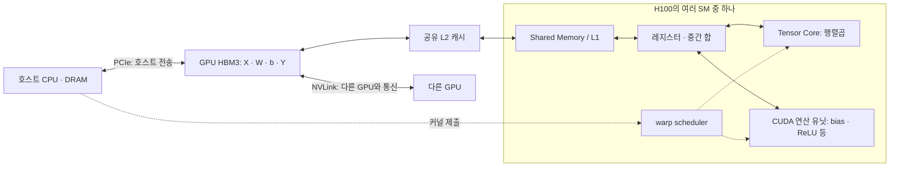
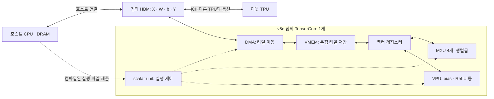
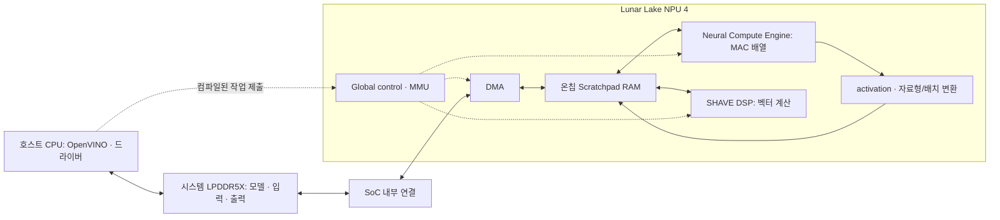

# ② 계산과 데이터 이동은 누가 맡을까?

[5주차 목차](./README.md) · 이전 → [① 비교 단위](./01-comparison-scope.md) · 다음 → [③ 사양](./03-specifications.md)

실선은 데이터 경로, 점선은 제어 관계다. 

## 1. NVIDIA H100 SXM: SM 안에 여러 역할이 있다

CUDA 커널의 thread block이 SM에 배치되고, scheduler가 실행 가능한 warp에 명령을 발행한다. Tensor Core는 SM 안의 행렬곱 장치다. bias·ReLU는 일반 연산 유닛에서 처리할 수 있다. 컴파일러나 라이브러리가 이를 같은 커널의 후처리로 합칠 수도 있다. [CUDA Programming Model](https://docs.nvidia.com/cuda/cuda-programming-guide/01-introduction/programming-model.html), [Scaling Book: GPU 구성과 TPU 대응](https://jax-ml.github.io/scaling-book/gpus/)

> **CTA(Cooperative Thread Array):** CUDA의 thread block을 가리킨다. CTA 안의 thread들은 공유 메모리와 동기화로 협력하며, 보통 하나의 SM에 배치된다. SM에는 자원 한도에 따라 여러 CTA가 동시에 상주할 수 있다.

---

> **H100에서 CTA 간 통신:** CTA는 기본적으로 서로의 공유 메모리를 직접 공유하지 않는다. 하지만 여러 CTA를 thread block cluster로 묶으면 분산 공유 메모리(Distributed Shared Memory)와 cluster 동기화로 통신할 수 있다. 클러스터 밖의 CTA와 데이터 교환은 보통 전역 메모리와 커널 간 동기화를 이용한다. [CUDA Programming Guide: Thread Block Clusters](https://docs.nvidia.com/cuda/cuda-programming-guide/04-special-topics/cooperative-groups.html#thread-block-clusters)

타일과 Shared Memory 사용은 커널·컴파일러가 결정하고 캐시는 하드웨어가 관리한다. H100의 TMA는 메모리 복사를 돕는다. **자동 캐시 재사용과 명시적으로 보관한 타일은 구분**한다. H100의 L1·Shared Memory 결합 용량 256 KB와 사용 가능한 Shared Memory 최대 228 KB/SM도 같은 값이 아니다. [Hopper Tuning Guide: TMA / Memory System](https://docs.nvidia.com/cuda/hopper-tuning-guide/index.html)

> **참고:** TMA(Tensor Memory Accelerator)는 전역 메모리와 Shared Memory 사이의 타일 전송을 비동기화해 계산과 데이터 이동을 겹치게 돕는다.

## 2. Google TPU v5e: TensorCore 안에 MXU·벡터·제어 장치가 있다

v5e는 칩당 TensorCore 하나와 MXU 네 개를 갖는다. [Google: v5e System architecture](https://docs.cloud.google.com/tpu/docs/v5e)

MXU가 행렬곱을, VPU가 원소별 계산을, scalar unit이 제어를 담당하는 구조다. 컴파일러가 타일 이동과 계산의 겹침을 계획한다. VMEM은 GPU L2와 달리 명시적인 작업 버퍼로 설명되며, 구체적인 배치는 XLA 또는 Pallas 프로그램에 달려 있다. [Scaling Book 2장: What Is a TPU?](https://jax-ml.github.io/scaling-book/tpus/)

> **참고:** DMA(Direct Memory Access)는 CPU가 데이터 하나하나를 복사하지 않고 메모리와 가속기 버퍼 사이의 전송을 수행한다. 전송 설정과 완료 동기화는 여전히 필요하다.

## 3. Intel Core Ultra 9 288V NPU: SoC 안의 추론 엔진

Intel의 NPU 4 자료에는 MAC 배열, activation·변환 파이프라인, SHAVE DSP, DMA, Scratchpad RAM이 구분되어 있다. 행렬곱은 MAC 배열, ReLU는 activation 경로 등으로 처리할 수 있다. [Intel Lunar Lake AI Hardware Accelerators, 슬라이드 25–35](https://cdrdv2-public.intel.com/824436/2024_Intel_Tech%20Tour%20TW_Lunar%20Lake%20AI%20Hardware%20Accelerators.pdf)

OpenVINO Python API에서는 사용자가 MAC 배열의 타일 배치나 하드웨어 동작을 직접 지정하는 대신, 모델을 컴파일하고 추론을 요청한다. 연산 배치와 메모리 이동은 NPU 컴파일러가 최적화한다. [OpenVINO 2026: NPU Device 도입부](https://docs.openvino.ai/2026/openvino-workflow/running-inference/inference-devices-and-modes/npu-device.html)

>MAC(Multiply-Accumulate)은 곱셈 결과를 누산하는 연산이다. MAC 배열은 이런 연산을 병렬로 수행해 행렬곱 등을 처리한다.

## 4. Tiling 관점에서 본다면

| 질문 | H100 SXM | TPU v5e | 288V NPU |
|---|---|---|---|
| 큰 텐서가 있는 메모리 | HBM | HBM | 공유 시스템 메모리 |
| 가까운 데이터 재사용 공간 | 캐시·Shared Memory·레지스터 | VMEM·벡터 레지스터 | Scratchpad·엔진 내부 저장 공간 |
| 이동과 실행을 누가 계획하는가? | 커널·컴파일러·라이브러리와 하드웨어 scheduler/캐시 | XLA/Pallas와 DMA·제어 장치 | NPU 컴파일러와 런타임·DMA·제어 장치 |
| 이번에 확인할 것 | 타일·fusion·캐시 hit·spill | 타일·padding·VMEM 사용·fusion | 컴파일 지원·배치·변환·실제 장치 실행 |
