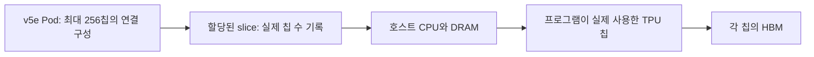
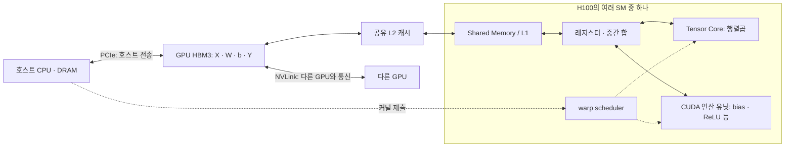
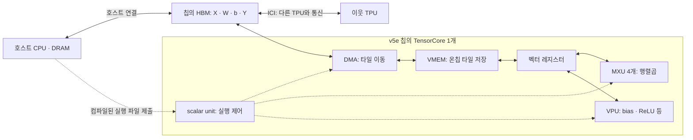
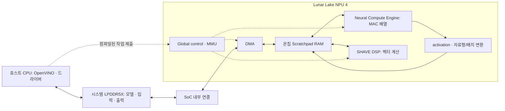

# 5주차 통합 문서: GPU·TPU·NPU 비교와 장치 실험

주차 안내와 ①~⑥ 학습 문서, 비교 기록 양식, 네 차례의 장치 실험 기록을 한 문서로 모았다. 비교 목적과 조건을 정한 뒤 하드웨어·사양·소프트웨어·측정 방법을 읽고 실제 결과를 살펴본다.

문헌 조사와 실측의 날짜·조건은 각 절에 기록된 기준을 따른다. 실험은 최초 비교 → JAX 통일 → CUDA·Pallas 비교 → A100 PyTorch 기준선 정정 순서다. A100의 PyTorch 대비 CUDA 결과는 [마지막 실험](#torch-cuda-experiment), TPU의 JAX 대비 Pallas 결과는 [CUDA·Pallas 실험](#native-experiment)을 참고한다.

코드 블록의 명령은 저장소 루트에서 실행한다. 코드·수식·측정값은 원문을 보존했으며, 원시 데이터와 실행 코드는 링크로 연결했다.

## 목차

- [5주차: GPU·TPU·NPU를 어떤 조건으로 비교할까?](#overview)
- [① 무엇을 비교할까: 칩·시스템·사용 목적](#comparison-scope)
- [② 계산과 데이터 이동은 누가 맡을까?](#hardware)
- [③ 성능표의 숫자는 어떤 조건의 값일까?](#specifications)
- [④ 같은 모델에서 장치 실행까지](#software)
- [⑤ 실제로 빠르다는 뜻: 무엇의 시간을 재었을까?](#measurement)
- [⑥ 같은 연산의 비교 조건표와 손계산](#comparison-exercise)
- [5주차 비교 기록 양식](#comparison-template)
- [week5-06 Colab 장치 실험 — 2026-10-19](#device-experiment)
- [week5-06 JAX 통일 실험 — 2026-10-19](#jax-device-experiment)
- [CUDA·Pallas 비교 실측](#native-experiment)
- [A100 기준선 정정: native PyTorch eager vs CUDA](#torch-cuda-experiment)


---

<a id="overview"></a>

## 5주차: GPU·TPU·NPU를 어떤 조건으로 비교할까?

같은 AI 작업에 쓸 가속기를 비교하려면 **작업·품질·측정 범위·장치 수**부터 맞춘다. 제품의 최대 연산 성능은 이 조건을 확인한 뒤 읽는다.

[4주차](../week4/README.md)에서는 Roofline과 Tiling으로 연산 성능·메모리 대역폭·데이터 재사용을 연결했다. 이번에는 그 관점으로 실제 제품의 구조, 소프트웨어 지원 조건, 성능표를 읽는다. 사례는 **NVIDIA H100 SXM, Google TPU v5e, Intel Core Ultra 9 288V의 NPU**다. 이 세 제품의 차이를 GPU·TPU·NPU 전체의 차이로 일반화하지 않는다.

본문의 제품 비교는 **2026-10-08에 확인한 문헌과 직접 계산한 예제**다. 이후 **2026-10-19 Colab 장치 실험**을 추가했다. 실제 할당 장치·버전·정확도·지연시간은 [실험 기록](#device-experiment)과 원시 결과를 따른다. H100·Intel NPU의 실측과 에너지 측정은 아직 없다. 문서의 버전과 실제 실행 환경의 버전을 구분한다.

추가로 [GPU·TPU 모두 JAX 0.11.1로 통일한 재실험](#jax-device-experiment)을 별도로 기록했다.

[시간 벤치마크 원시 기록 노트북](../notebooks/week5_benchmark_timings.ipynb)은 저장된 JSON만 읽어 지연시간 분포·seed별 추이·실험 간 비교를 보여준다. GPU 없이 로컬 Python에서 실행할 수 있다.

<a id="overview-section-1"></a>

### 1. 공통으로 읽을 자료

| 자료 | 읽을 범위 | 중심 질문 |
|---|---|---|
| [Scaling Book 12장: How to Think About GPUs](https://jax-ml.github.io/scaling-book/gpus/) | **GPUs vs. TPUs at the chip level**부터. 필요하면 **What Is a GPU? / Memory** | 행렬곱·원소별 연산·실행 제어·데이터 재사용은 어디서 이루어지는가? |
| [OpenVINO 2026: NPU Device](https://docs.openvino.ai/2026/openvino-workflow/running-inference/inference-devices-and-modes/npu-device.html) | 도입부의 컴파일 예, **Supported Inference Data Types / Dynamic Shapes / Limitations** | 입력 자료형·shape·컴파일러·드라이버가 지원 여부에 어떤 영향을 주는가? |
| [MLPerf Inference: Datacenter](https://mlcommons.org/benchmarks/inference-datacenter/) | **Scenarios & Metrics / Divisions / Submission Information** | 모델·품질·요청 방식·장치 수·소프트웨어를 왜 함께 기록하는가? |

Scaling Book의 과거 가격은 현재 가격으로 사용하지 않는다. 구조 설명에 등장하는 TPU v5p·v6e 등의 수치를 v5e에 옮겨 적지 않는다. OpenVINO의 `/2026/`, JAX의 `/latest/`, MLPerf의 현재 규칙 페이지도 갱신되므로 열람일과 실제 사용한 릴리스를 남긴다.

<a id="overview-section-2"></a>

### 2. 주제별 학습 문서

| 순서 | 문서 | 읽고 설명할 내용 |
|---|---|---|
| ① | [비교 단위와 사용 목적](#comparison-scope) | 칩·호스트·시스템, 학습·추론, 커널 비교·품질 비교 |
| ② | [하드웨어 구조와 데이터 이동](#hardware) | 세 제품의 연산 장치·큰 메모리·온칩 저장 공간·호스트 연결 그림 |
| ③ | [FLOPs/s·TOPS와 제품 사양 읽기](#specifications) | 자료형·누산·희소성·집계 단위·메모리와 연결 대역폭 |
| ④ | [모델에서 장치 실행까지](#software) | CUDA·Triton, JAX·XLA·Pallas, OpenVINO NPU 경로와 지원 조건 |
| ⑤ | [지연시간·처리량·품질·에너지](#measurement) | 컴파일·전송·준비 실행·동기화, MLPerf 결과를 읽는 순서 |
| ⑥ | [공통 연산의 비교 조건표와 손계산](#comparison-exercise) | 배치 1·128 조건표, 가상 장치의 Roofline 계산 |

④의 지원 조건과 ⑥의 표는 함께 읽는다. 모델 입력이 FP32라는 사실만으로 내부 곱셈과 누산까지 FP32라고 판정할 수는 없다.

<a id="overview-section-3"></a>

### 3. 각자 정리할 내용

한 제품을 맡아 [제출용 기록 양식](#comparison-template)을 채운다.

1. 제조사·제품·세대·할당된 장치 수와 실제 연산에 사용한 수를 적는다.
2. 운영체제·프레임워크·컴파일러·런타임·드라이버의 정확한 버전을 남긴다. 실행하지 않았다면 그 사실을 적는다.
3. 연산 장치·메모리·실행 경로를 작은 그림으로 연결한다.
4. 비교표의 숫자에 자료형·희소성·배치·측정 범위와 출처를 붙인다.
5. 확인하지 못한 조건과 그 때문에 아직 내릴 수 없는 결론을 적는다.

| 표기 | 사용 기준 |
|---|---|
| 문헌 확인 | 출처와 해당 절에서 직접 확인한 사실 |
| 계산 | 입력값·가정·공식으로 구한 값. 실측과 구분 |
| 미공개 | 출처에서 비공개라고 명시한 값. 검색에서 찾지 못했다는 뜻으로 쓰지 않음 |
| 이번 조사에서 미확인 | 확인한 문헌만으로 값을 확정할 수 없음 |
| 아직 미측정 | 장치에서 실행·측정하지 않음 |

<a id="overview-section-4"></a>

### 4. 공통 과제

추론 연산 `Y = ReLU(XW + b)`를 사용한다.

- `X: [M, 1024]`, `W: [1024, 1024]`, `b: [1024]`, `Y: [M, 1024]`
- `M = 128`과 `M = 1`을 별도로 비교한다. 역전파와 가중치 갱신은 없다.
- **커널 비교:** 입력·계산·누산·출력 자료형까지 맞춘다. 지원을 확인하지 못한 장치는 동등한 조건의 결과로 넣지 않는다.
- **모델·시스템 비교:** 같은 입력과 품질 목표를 맞추고 각 장치의 실행 경로를 허용한다. 내부 정밀도와 장치별 분담은 공개한다.

[⑥의 조건표와 풀이](#comparison-exercise)를 채우면 문헌 조사만으로도 참여할 수 있다. 가상 장치 A·B 계산은 다음 명령으로 재현한다. Python 표준 라이브러리만 사용하며 실제 가속기 성능을 측정하지 않는다.

```bash
python3 week5/calculate_comparison.py
```

<a id="overview-section-5"></a>

### 5. 선택 실습: 무료 원격 환경과 CPU 참여

[Colab 공식 FAQ](https://research.google.com/colaboratory/faq.html)는 무료 GPU·TPU 자원과 함께, 할당·제품 종류·사용 한도가 보장되지 않는다고 설명한다. **H100 SXM이나 TPU v5e를 무료로 배정받는다는 뜻은 아니다.** 실제 배정된 제품명으로 비교표를 바꾼다.

| 참여 방식 | 시작할 곳 | 이번 주에 남길 내용 |
|---|---|---|
| Colab GPU | [기존 PyTorch GPU 노트북](../notebooks/pytorch_gpu_relu_linear.ipynb) · [Colab에서 열기](https://colab.research.google.com/github/Jake-Song/tensor2silicon/blob/main/notebooks/pytorch_gpu_relu_linear.ipynb) | 실제 GPU·메모리·장치 수·버전, 추론 설정, 두 shape의 실행 경로 |
| Colab TPU | [기존 JAX TPU 노트북](../notebooks/jax_tpu_relu_linear.ipynb) · [Colab에서 열기](https://colab.research.google.com/github/Jake-Song/tensor2silicon/blob/main/notebooks/jax_tpu_relu_linear.ipynb) | 실제 TPU 세대·할당 수·사용 수, JAX/jaxlib/libtpu 버전, 컴파일·완료 대기 |
| 로컬 Intel NPU | [OpenVINO NPU 문서](https://docs.openvino.ai/2026/openvino-workflow/running-inference/inference-devices-and-modes/npu-device.html) | 보유 장치의 정확한 SKU, NPU 인식·컴파일·출력 검증 결과 |
| CPU·문헌·시뮬레이션 | [⑥ 손계산](#comparison-exercise), 위 계산 스크립트, [기존 CPU 그래프 노트북](../notebooks/xla_fx_graphviz.ipynb) | FLOPs·Byte·산술 강도·가정. CPU나 시뮬레이터 시간은 해당 환경의 결과로 표시 |

기존 GPU·TPU 노트북은 컴파일 경로를 탐색하는 자료다. 현재 shape·자료형·역전파 셀을 그대로 실행해 이번 주의 벤치마크로 사용하지 않는다. GPU에서는 추론만 남기고, TPU에서는 Pallas의 `interpret` 대체 실행 여부를 확인한다. 해석 모드 결과를 네이티브 Pallas 커널 성능으로 기록하지 않는다.

Core Ultra 9 288V NPU를 지정해 쓸 수 있는 무료 원격 서비스는 이번 조사에서 확인하지 못했다. NPU 장비가 없다면 문헌 조사와 계산으로 참여하면 된다.

<a id="overview-section-6"></a>

### 6. 모임에서 확인할 질문

- H100의 sparse BF16 수치, v5e의 BF16 수치, 288V NPU의 INT8 TOPS를 한 줄로 정렬하면 무엇이 빠지는가?
- GPU의 Tensor Core와 TPU의 TensorCore를 같은 크기의 구성 단위로 세어도 되는가?
- 배치 128의 시간이 배치 1보다 길어도 samples/s는 높아질 수 있는가?
- 출력 dtype, 실제 누산, 출력 직전 반올림을 각각 확인했는가?
- 장치 내부 시간이 빨라도 전체 요청 시간이 느려지는 경로는 무엇인가?
- 같은 가중치를 반복 측정할 때 캐시 상태가 Roofline의 이동량 가정을 바꾸는가?
- 어떤 추가 측정이 있어야 제품의 우열을 말할 수 있는가?


---

<a id="comparison-scope"></a>

## ① 무엇을 비교할까: 칩·시스템·사용 목적

[5주차 목차](#overview) · 다음 → [② 하드웨어](#hardware)

제품명을 정하기 전에 질문을 정한다. “행렬곱 한 번이 얼마나 빠른가?”, “동시에 들어오는 요청을 몇 개 처리하는가?”, “노트북에서 한 요청에 얼마의 에너지를 쓰는가?”는 서로 다른 실험이다.

<a id="comparison-scope-section-1"></a>

### 1. 이번 주의 조사 대상

| 제조사·제품·세대 | 비교할 연산 자원 | 실행 환경 | 확인 상태 |
|---|---|---|---|
| NVIDIA H100 **SXM**, Hopper | 전체 GPU 1개 사용을 가정. MIG 분할 여부는 실습 때 확인 | CPU 호스트가 있는 서버 | 문헌 조사. 서버 구성·실행 버전·성능은 아직 미측정 |
| Google TPU **v5e** | TPU 칩 1개 사용을 가정 | Cloud TPU 호스트와 가속기 | 문헌 조사. 실제 할당 slice·호스트·소프트웨어는 미확인 |
| Intel Core Ultra **9 288V**, Series 2 / Lunar Lake, Intel AI Boost NPU | 프로세서에 통합된 NPU 1개 | CPU·GPU·NPU를 포함한 개인 기기 | 문헌 조사. 노트북 모델·OS·드라이버·실행 성능은 미확인 |

제품·폼팩터는 [H100 사양](https://www.nvidia.com/en-us/data-center/h100/), [TPU v5e 문서](https://docs.cloud.google.com/tpu/docs/v5e), [288V 사양](https://www.intel.com/content/www/us/en/products/sku/240961/intel-core-ultra-9-processor-288v-12m-cache-up-to-5-10-ghz/specifications.html)을 기준으로 한다. 설치 버전 기록 항목은 [④](#software)에 있다.

NPU는 신경망 가속기를 가리키는 넓은 이름이고 TPU도 신경망용 가속기다. 여기서 GPU·TPU·NPU라는 세 열은 **세 제품 사례의 약칭**이다.

<a id="comparison-scope-section-2"></a>

### 2. 칩 하나와 시스템 하나는 다르다

v5e 문서의 기본 시스템 표는 **칩당 HBM**, **호스트당 8칩**, **Pod당 256칩**을 구분한다. serving에는 1·4·8칩 slice 구성이 있다. [Google: v5e System architecture / Configurations](https://docs.cloud.google.com/tpu/docs/v5e)



장치별 peak를 더한 값은 집계된 이론값이다. 실제 처리량에는 분할 방식·통신·불균형·호스트 작업이 영향을 준다. 8개 장치의 시간을 8로 나누거나 처리량을 8로 나눠 단일 장치의 실측값으로 바꿀 수 없다.

<a id="comparison-scope-section-3"></a>

### 3. 같은 질문 안에서 비교하기

| 비교 목적 | 맞출 조건 | 이 비교로 답할 수 없는 질문 |
|---|---|---|
| 같은 연산의 커널 | 식·shape·값·자료형·희소성·메모리 경계·완료 기준 | 다른 모델의 품질·서비스 처리량 |
| 같은 모델의 추론 | 가중치·입력·품질 목표·전처리·출력·배치·실행 범위 | 학습 수렴 시간 |
| 서비스 처리량 | 모델·품질·요청 분포·동시성·지연시간 제한·장치 수 | 한 요청의 최소 지연시간 |
| 개인 기기의 추론 | 품질·응답시간·전력 모드·기기 전체 에너지·열 상태 | 데이터센터의 확장 효율 |
| 학습 | 데이터·정밀도·optimizer·목표 품질까지의 step 수·통신 | 같은 제품의 추론 성능 |

<a id="comparison-scope-section-4"></a>

### 4. 두 종류의 공정성

**커널 비교는 계산 조건을 고정한다.** 예를 들어 X·W가 BF16이고 FP32로 누산한 뒤 FP32 bias·ReLU·출력을 사용한다면, 입력 파일이 FP32라는 이유만으로 동등하다고 볼 수 없다. 이 정밀도 계약을 지원하는지부터 확인한다.

**모델·시스템 비교는 품질과 사용 조건을 고정한다.** 내부에서는 BF16·FP16·INT8 경로가 다를 수 있다. 양자화·장치 분담·호스트 전송에 따라 결과가 달라질 수 있다.

“A가 빠르다”를 다음처럼 바꿔 쓰면 검증할 수 있다.

> A 제품 1개, 해당 소프트웨어 버전, 배치 128, 지정한 정밀도와 오차 기준에서, 준비 실행 후 장치 상주 입력의 동기화된 호출 시간이 B보다 짧았다.


---

<a id="hardware"></a>

## ② 계산과 데이터 이동은 누가 맡을까?

[5주차 목차](#overview) · 이전 → [① 비교 단위](#comparison-scope) · 다음 → [③ 사양](#specifications)

실선은 데이터 경로, 점선은 제어 관계다.

<a id="hardware-section-1"></a>

### 1. NVIDIA H100 SXM: SM 안에 여러 역할이 있다



CUDA 커널의 thread block이 SM에 배치되고, scheduler가 실행 가능한 warp에 명령을 발행한다. Tensor Core는 SM 안의 행렬곱 장치다. bias·ReLU는 일반 연산 유닛에서 처리할 수 있다. 컴파일러나 라이브러리가 이를 같은 커널의 후처리로 합칠 수도 있다. [CUDA Programming Model](https://docs.nvidia.com/cuda/cuda-programming-guide/01-introduction/programming-model.html), [Scaling Book: GPU 구성과 TPU 대응](https://jax-ml.github.io/scaling-book/gpus/)

> **CTA(Cooperative Thread Array):** CUDA의 thread block을 가리킨다. CTA 안의 thread들은 공유 메모리와 동기화로 협력하며, 보통 하나의 SM에 배치된다. SM에는 자원 한도에 따라 여러 CTA가 동시에 상주할 수 있다.

---

> **H100에서 CTA 간 통신:** CTA는 기본적으로 서로의 공유 메모리를 직접 공유하지 않는다. 하지만 여러 CTA를 thread block cluster로 묶으면 분산 공유 메모리(Distributed Shared Memory)와 cluster 동기화로 통신할 수 있다. 클러스터 밖의 CTA와 데이터 교환은 보통 전역 메모리와 커널 간 동기화를 이용한다. [CUDA Programming Guide: Thread Block Clusters](https://docs.nvidia.com/cuda/cuda-programming-guide/04-special-topics/cooperative-groups.html#thread-block-clusters)

타일과 Shared Memory 사용은 커널·컴파일러가 결정하고 캐시는 하드웨어가 관리한다. H100의 TMA는 메모리 복사를 돕는다. **자동 캐시 재사용과 명시적으로 보관한 타일은 구분**한다. H100의 L1·Shared Memory 결합 용량 256 KB와 사용 가능한 Shared Memory 최대 228 KB/SM도 같은 값이 아니다. [Hopper Tuning Guide: TMA / Memory System](https://docs.nvidia.com/cuda/hopper-tuning-guide/index.html)

> **참고:** TMA(Tensor Memory Accelerator)는 전역 메모리와 Shared Memory 사이의 타일 전송을 비동기화해 계산과 데이터 이동을 겹치게 돕는다.

<a id="hardware-section-2"></a>

### 2. Google TPU v5e: TensorCore 안에 MXU·벡터·제어 장치가 있다



v5e는 칩당 TensorCore 하나와 MXU 네 개를 갖는다. [Google: v5e System architecture](https://docs.cloud.google.com/tpu/docs/v5e)

MXU가 행렬곱을, VPU가 원소별 계산을, scalar unit이 제어를 담당하는 구조다. 컴파일러가 타일 이동과 계산의 겹침을 계획한다. VMEM은 GPU L2와 달리 명시적인 작업 버퍼로 설명되며, 구체적인 배치는 XLA 또는 Pallas 프로그램에 달려 있다. [Scaling Book 2장: What Is a TPU?](https://jax-ml.github.io/scaling-book/tpus/)

> **참고:** DMA(Direct Memory Access)는 CPU가 데이터 하나하나를 복사하지 않고 메모리와 가속기 버퍼 사이의 전송을 수행한다. 전송 설정과 완료 동기화는 여전히 필요하다.

<a id="hardware-section-3"></a>

### 3. Intel Core Ultra 9 288V NPU: SoC 안의 추론 엔진



Intel의 NPU 4 자료에는 MAC 배열, activation·변환 파이프라인, SHAVE DSP, DMA, Scratchpad RAM이 구분되어 있다. 행렬곱은 MAC 배열, ReLU는 activation 경로 등으로 처리할 수 있다. [Intel Lunar Lake AI Hardware Accelerators, 슬라이드 25–35](https://cdrdv2-public.intel.com/824436/2024_Intel_Tech%20Tour%20TW_Lunar%20Lake%20AI%20Hardware%20Accelerators.pdf)

OpenVINO Python API에서는 사용자가 MAC 배열의 타일 배치나 하드웨어 동작을 직접 지정하는 대신, 모델을 컴파일하고 추론을 요청한다. 연산 배치와 메모리 이동은 NPU 컴파일러가 최적화한다. [OpenVINO 2026: NPU Device 도입부](https://docs.openvino.ai/2026/openvino-workflow/running-inference/inference-devices-and-modes/npu-device.html)

>MAC(Multiply-Accumulate)은 곱셈 결과를 누산하는 연산이다. MAC 배열은 이런 연산을 병렬로 수행해 행렬곱 등을 처리한다.


<a id="hardware-section-4"></a>

### 4. Tiling 관점에서 본다면

| 질문 | H100 SXM | TPU v5e | 288V NPU |
|---|---|---|---|
| 큰 텐서가 있는 메모리 | HBM | HBM | 공유 시스템 메모리 |
| 가까운 데이터 재사용 공간 | 캐시·Shared Memory·레지스터 | VMEM·벡터 레지스터 | Scratchpad·엔진 내부 저장 공간 |
| 이동과 실행을 누가 계획하는가? | 커널·컴파일러·라이브러리와 하드웨어 scheduler/캐시 | XLA/Pallas와 DMA·제어 장치 | NPU 컴파일러와 런타임·DMA·제어 장치 |
| 이번에 확인할 것 | 타일·fusion·캐시 hit·spill | 타일·padding·VMEM 사용·fusion | 컴파일 지원·배치·변환·실제 장치 실행 |


---

<a id="specifications"></a>

## ③ 성능표의 숫자는 어떤 조건의 값일까?

[5주차 목차](#overview) · 이전 → [② 하드웨어](#hardware) · 다음 → [④ 소프트웨어](#software)

<a id="specifications-section-1"></a>

### 1. 공시 연산 성능

| 대상·집계 범위 | 표기값 | 읽어야 할 조건 | 아직 연결할 수 없는 값 |
|---|---|---|---|
| H100 SXM GPU 1개, BF16 Tensor Core | **약 990 TFLOP/s (추산)** | sparsity 적용 공시값 1,979를 절반으로 환산 | dense `XW`의 실제 처리율 |
| H100 SXM GPU 1개, INT8 Tensor Core | **약 1,979 TOPS (추산)** | sparsity 적용 공시값 3,958을 절반으로 환산. BF16과 자료형이 다름 | BF16 커널의 실행시간 |
| TPU v5e 칩 1개, BF16 | **197 TFLOP/s** | 칩당 peak. 사양 표에 별도 sparse 배수 각주 없음 | 특정 shape의 실제 MXU 이용률 |
| TPU v5e 칩 1개, INT8 | **393 TOPS** | 정수 연산 peak. BF16 행과 분리 | 양자화·변환을 포함한 추론 시간 |
| Core Ultra 9 288V의 NPU | **48 TOPS, INT8** | NPU 항목. `Sparsity Support: Yes`는 별도 항목 | 사양 페이지에서 48의 dense/sparse 조건·누산은 이번 조사에서 미확인 |
| Core Ultra 9 288V 전체 | **120 TOPS, INT8** | NPU만의 값이 아닌 프로세서 전체 항목 | 한 그래프가 이 처리율을 달성한다는 보장 |

출처: [NVIDIA H100 Product Specifications의 **SXM 열과 각주**][specifications-h100], [Google TPU v5e System architecture][specifications-v5e], [Intel 288V Essentials / NPU Specifications][specifications-intel].

> **추산값 안내:** H100의 표 값은 구조화된 sparsity 적용 공시 peak를 절반으로 나눈 dense 대응 추정치다. 실측 성능이나 보장값은 아니며, 조건에 맞는 희소성 형식과 실행 경로가 필요하다. 임의의 0이 많은 행렬에 그대로 적용되는 값이 아니다. [NVIDIA Hopper Architecture의 sparsity 설명][specifications-hopper]

<a id="specifications-section-2"></a>

### 2. 입력·계산·누산·출력은 각각 적는다

| 예시 경로 | 입력·가중치 | 곱셈·누산 | bias·출력 | 확인할 조건 |
|---|---|---|---|---|
| 공통 커널 비교 계약 | BF16 | BF16 곱셈 / FP32 누산 | FP32 | 이 계약을 실제로 지킨 구현끼리 비교 |
| H100 Tensor Core 구현 후보 | BF16 | BF16 / FP32를 선택하고 생성 코드로 확인 | FP32를 유지하도록 구현 | 사양의 BF16 peak만으로 구현을 확인할 수 없음 |
| v5e MXU 구현 후보 | BF16 | BF16 / FP32 경로. JAX의 반환 dtype·정밀도 설정도 확인 | FP32를 유지하도록 구현 | 출력 dtype만으로 내부 알고리즘을 단정하지 않음 |
| OpenVINO NPU 비양자화 경로 | 모델에 FP32/F16 표현 가능 | 문서는 HW 계산 FP16 명시. 실제 누산은 이번 조사에서 미확인 | 그래프·변환·실행 결과 확인 | FP32 모델 입력을 FP32 하드웨어 계산으로 해석하지 않음 |

<a id="specifications-section-3"></a>

### 3. 메모리와 연결 대역폭

| 항목 | H100 SXM 1개 | TPU v5e 1칩 | 288V NPU 1개 |
|---|---|---|---|
| 큰 메모리 | 80 GB HBM3 | 16 GB HBM, 공식 표기 유지 | 프로세서 사양 최대 32 GB LPDDR5X. NPU 전용 용량이 아님 |
| 큰 메모리 대역폭 | 3.35 TB/s | **800 GiB/s**, 확인한 공식 문서 표기 | NPU가 지속적으로 쓸 수 있는 유효 대역폭은 아직 미측정 |
| 온칩 저장 공간 | H100 L2 50 MB, Shared Memory·레지스터 | VMEM·벡터 레지스터. v5e의 상세 용량은 이번 조사에서 미확인 | Scratchpad 등. 해당 SKU의 상세 용량은 이번 조사에서 미확인 |
| 가속기 간 연결 | NVLink 900 GB/s, 양방향 합계 | ICI 400 GB/s/칩, 양방향 합계 | 이번 단일 NPU 과제에서 해당 없음 |
| 호스트 연결 | PCIe Gen5 128 GB/s, 양방향 합계 | 호스트 연결의 해당 구성별 대역폭은 이번 조사에서 미확인 | SoC 내부 연결·공유 메모리. GPU의 PCIe 전송 모델과 구분 |

출처: [H100 제품 표][specifications-h100], [Hopper Tuning Guide의 L2 / NVLink][specifications-tuning], [Hopper Architecture의 PCIe 설명][specifications-hopper], [v5e 표][specifications-v5e], [Intel 메모리 사양][specifications-intel], [NPU 4 구조 자료][specifications-npu4]. 상세 메모리 구조는 [②](#hardware)를 참고한다.

- `1 TB/s = 10¹² Byte/s`, `1 GiB/s = 2³⁰ Byte/s`다. 위 v5e 값은 계산하면 약 **858.99 GB/s**다. Scaling Book은 `8.2×10¹¹ Byte/s` 표기

<a id="specifications-section-4"></a>

### 4. 전력 사양을 읽는 법

H100 SXM의 최대 TDP는 설정 가능한 **최대 700 W**다. 288V의 **Processor Base Power 30 W / Maximum Turbo Power 37 W**는 프로세서 전력 항목이며 NPU 단독의 측정 전력이 아니다. v5e의 칩 전력은 이번에 확인한 사양 표에서 확인하지 못했다. [H100][specifications-h100], [Intel 288V][specifications-intel]

같은 품질·부하·측정 경계에서 J/request 또는 J/sample 구할 수 있다. 계산 방법은 [⑤](#measurement)에 있다.

> **참고:** TDP(Thermal Design Power)는 열·전력 설계를 위한 제품 사양이지, 작업 중 실제 소비전력이나 에너지 측정값은 아니다. 제품마다 전력 항목의 정의와 범위도 다를 수 있다.

[specifications-h100]: https://www.nvidia.com/en-us/data-center/h100/
[specifications-v5e]: https://docs.cloud.google.com/tpu/docs/v5e
[specifications-intel]: https://www.intel.com/content/www/us/en/products/sku/240961/intel-core-ultra-9-processor-288v-12m-cache-up-to-5-10-ghz/specifications.html
[specifications-hopper]: https://developer.nvidia.com/blog/nvidia-hopper-architecture-in-depth/
[specifications-tuning]: https://docs.nvidia.com/cuda/hopper-tuning-guide/index.html
[specifications-triton]: https://triton-lang.org/main/getting-started/tutorials/03-matrix-multiplication.html
[specifications-tpus]: https://jax-ml.github.io/scaling-book/tpus/
[specifications-jax-dot]: https://docs.jax.dev/en/latest/_autosummary/jax.lax.dot.html
[specifications-npu]: https://docs.openvino.ai/2026/openvino-workflow/running-inference/inference-devices-and-modes/npu-device.html
[specifications-npu4]: https://cdrdv2-public.intel.com/824436/2024_Intel_Tech%20Tour%20TW_Lunar%20Lake%20AI%20Hardware%20Accelerators.pdf


---

<a id="software"></a>

## ④ 같은 모델에서 장치 실행까지

[5주차 목차](#overview) · 이전 → [③ 사양](#specifications) · 다음 → [⑤ 측정](#measurement)

<a id="software-section-1"></a>

### 1. 세 실행 경로

| 대상 | 모델 수준의 경로 | 직접 커널을 다룰 때 | 지원·실행 확인 항목 |
|---|---|---|---|
| NVIDIA H100 SXM | 프레임워크 그래프 → GPU 라이브러리 또는 생성된 커널 → CUDA 실행 | CUDA에서는 thread/block·메모리·동기화, Triton에서는 블록 단위 계산·타일·입출력 경계를 표현 | 프레임워크의 실제 실행 로그, 생성 코드, CUDA 대상 아키텍처, 라이브러리·Triton의 연산과 dtype 조건 |
| Google TPU v5e | JAX 함수 → 추적·jaxpr → XLA 컴파일 → TPU 실행 | Pallas로 블록·메모리 접근·커널 계산을 작성하고 TPU backend로 컴파일 | JAX/XLA lowering 오류, shape·dtype, Pallas TPU 지원 범위, jax/jaxlib/libtpu 조합 |
| Intel 288V NPU | 모델 변환·읽기 → OpenVINO 그래프 → NPU plugin·compiler → 드라이버·NPU | 경로는 모델 컴파일 API. CUDA/Triton 커널을 NPU에 그대로 넘기는 경로가 아님 | 장치 인식, `query_model`, NPU 대상 컴파일 로그, 실행·출력 검증 |

근거: [CUDA Programming Model][software-cuda], [Triton MatMul][software-triton], [JAX JIT][software-jax-jit], [Pallas TPU MatMul][software-pallas], [OpenVINO NPU][software-npu], [OpenVINO Core API][software-ov-core].

커널을 직접 작성하면 타일 재사용과 fusion을 제어할 여지가 생기지만, 프레임워크의 기존 최적화보다 항상 빠른 것은 아니다. `matmul → add → relu` 그래프가 있다고 해서 하나의 fused 커널이 올바르게 생성되었다고 볼 수 없다. 실제로는 실행 파일이나 프로파일에서 확인해야 한다.

<a id="software-section-2"></a>

### 2. NVIDIA: host와 device의 역할

호스트는 메모리를 준비하고 GPU 작업을 제출한다. CUDA 커널은 thread block들로 실행된다. 라이브러리에 MatMul을 맡길 수도 있고 Triton으로 행렬곱과 bias·ReLU를 함께 계산할 수도 있다. [CUDA][software-cuda], [Triton][software-triton]

이번 strict 커널 조건에서는 X·W를 BF16, 누산·bias·ReLU·Y를 FP32로 유지한다. MatMul 결과를 BF16으로 먼저 저장한 뒤 FP32 bias를 더하면 **중간 반올림이 추가된다.**

GPU 커널 제출은 비동기일 수 있다. 호스트 함수가 돌아온 시점만 재면 실행 완료 시간이 아니다. 장치 event 또는 명시적인 완료 대기가 필요하다. [CUDA: Asynchronous Execution][software-cuda-async]

> **참고:** FP32 결과를 BF16으로 변환해 저장할 때 BF16으로 표현 가능한 값으로 반올림되며, 이후 FP32로 변환해도 버려진 정밀도는 복원되지 않는다.

<a id="software-section-3"></a>

### 3. TPU: JIT 컴파일과 정밀도를 구분한다

`jax.jit`의 첫 실행에는 추적·컴파일이 포함될 수 있고, 같은 조건의 다음 호출은 컴파일된 코드를 재사용한다. [JAX JIT][software-jax-jit]

JAX의 dot 연산은 `precision`과 `preferred_element_type`을 구분한다. 후자는 출력 dtype을 지정하며, 알고리즘을 별도로 지정하지 않은 경우 누산 dtype에 대한 **컴파일러 힌트**이기도 하다. BF16 입력과 FP32 출력 설정, 컴파일 산출물, 오차를 함께 확인한다. [JAX dot API][software-jax-dot]

Pallas는 이보다 낮은 수준에서 블록과 커널을 표현한다. TPU 타일의 배수 제약·padding·경계 처리를 확인해야 하므로, 배치 128용 커널을 배치 1에 그대로 적용하지 않는다. [Pallas TPU MatMul][software-pallas]

[software-cuda]: https://docs.nvidia.com/cuda/cuda-programming-guide/01-introduction/programming-model.html
[software-cuda-async]: https://docs.nvidia.com/cuda/cuda-programming-guide/02-basics/asynchronous-execution.html
[software-triton]: https://triton-lang.org/main/getting-started/tutorials/03-matrix-multiplication.html
[software-jax-jit]: https://docs.jax.dev/en/latest/jit-compilation.html
[software-jax-dot]: https://docs.jax.dev/en/latest/_autosummary/jax.lax.dot.html
[software-pallas]: https://docs.jax.dev/en/latest/pallas/tpu/matmul.html
[software-npu]: https://docs.openvino.ai/2026/openvino-workflow/running-inference/inference-devices-and-modes/npu-device.html

[software-ov-core]: https://docs.openvino.ai/2026/api/ie_python_api/_autosummary/openvino.Core.html


---

<a id="measurement"></a>

## ⑤ 실제로 빠르다는 뜻: 무엇의 시간을 재었을까?

[5주차 목차](#overview) · 이전 → [④ 소프트웨어](#software) · 다음 → [⑥ 조건표·계산](#comparison-exercise)

<a id="measurement-section-1"></a>

### 1. 시간의 시작과 끝


직렬 경로를 보여주는 그림이다. 비동기 서비스에서는 전송·계산·다른 요청이 겹칠 수 있다.

GPU event로 얻은 시간과 JAX `block_until_ready()`를 포함한 호스트 시간을 바로 비교하지 않는다. NPU에 동등한 장치 타이머가 없다면 세 장치 모두 **동기화된 호출 시간**이나 **전체 요청 시간**처럼 공통으로 구현 가능한 범위로 맞춘다.

<a id="measurement-section-2"></a>

### 2. 배치 지연시간과 처리량

이 과제에서 X의 **한 행을 sample 하나**, M행의 호출을 **batch 하나**로 정의한다.

즉, `X`의 shape이 `[M, K]`라면 각 행은 특성 K개를 가진 입력 하나다. `XW+b`는 각 행에 같은 가중치 `W`와 bias `b`를 적용해 대응하는 출력 행을 만든다. 따라서 한 번의 호출에서 M개 입력을 함께 처리하며 batch size는 M이다. `M=1`이면 1-sample batch, `M=128`이면 128-sample batch다.

$$
\text{batch latency}=t_M\ [\mathrm{ms/batch}],\qquad
\text{samples/s}=\frac{R\times M}{T\ [\mathrm{s}]}
$$

- R: 측정 구간에 완료한 **호출 수**
- M: 배치


| 배치 | 지연시간 기록 | 처리량 기록 | 해석할 때 주의할 점 |
|---|---|---|---|
| M=1 | ms / 1-sample batch, p50·p95 등 | samples/s, 요청 하나=한 행이면 requests/s도 가능 | 작은 작업은 제출·동기화 비용이 지배할 수 있음 |
| M=128 | ms / 128-sample batch, p50·p95 등 | samples/s와 batches/s를 구분 | `t₁₂₈ / 128`은 분담된 시간이며 한 요청이 기다린 시간이 아님 |

<a id="measurement-section-3"></a>

### 3. 전력과 sample당 에너지

$$
E=\int_{t_0}^{t_1}P(t)\,dt\ [\mathrm{J}],\qquad
E_{\mathrm{sample}}=\frac{E}{\text{완료한 sample 수}}
$$

전력은 단위 시간당 에너지이므로 `P(t)=dE/dt`다. 아주 짧은 시간 `dt` 동안 소비한 에너지는 `dE=P(t)dt`이고, 이를 측정 시작 `t₀`부터 끝 `t₁`까지 누적하면 `E=∫[t₀,t₁]P(t)dt`가 된다. 여기서 J(줄, joule)는 에너지의 SI 단위다.

실제 계측에서는 시간 간격 `Δt`마다 전력을 읽어 `E≈ΣᵢPᵢΔt`로 근사한다. 얻은 에너지를 같은 측정 구간에 완료한 sample 수로 나누면 sample 하나당 에너지(J/sample)가 된다.

예를 들어 평균 100 W로 2초 동안 실행해 sample 200개를 완료했다면 `E=100×2=200 J`, 즉 `E_sample=200/200=1 J/sample`이다.


---

<a id="comparison-exercise"></a>

## ⑥ 같은 연산의 비교 조건표와 손계산

[5주차 목차](#overview) · 이전 → [⑤ 측정](#measurement) · [제출용 양식](#comparison-template)

$$
Y=\operatorname{ReLU}(XW+b),\quad
X\in\mathbb{R}^{M\times1024},\quad
W\in\mathbb{R}^{1024\times1024},\quad
b\in\mathbb{R}^{1024},\quad M\in\{1,128\}
$$

b는 모든 행에 broadcast한다. 추론만 수행하며 학습·gradient·optimizer는 없다. 아래의 **설계 조건**, **문헌 확인**, **계산**, **아직 미측정**을 구분한다.

<a id="comparison-exercise-section-1"></a>

### 1. 먼저 비교 계약을 둘로 나눈다

| 조건 | A. 같은 연산 조건의 커널 비교 | B. 같은 품질 목표의 모델·시스템 비교 |
|---|---|---|
| 식·shape | 위 식, M=1과 128을 별도로 실행 | 동일 |
| 원본 데이터 | 모든 장치에 동일한 값·layout | 동일한 FP32 원본·동일한 평가 입력 |
| 입력·가중치 | X·W를 **한 번 BF16으로 반올림한 동일한 값** | FP32 원본에서 각 경로로 변환. 변환 방법 기록 |
| 계산·누산 | BF16 곱셈, FP32 누산 | 각 장치의 지원 경로 허용. dtype·양자화·누산 공개 |
| bias·ReLU·출력 | FP32. MatMul 뒤 저정밀도 저장을 끼우지 않음 | FP32로 출력 회수·비교. 내부 변환과 반올림 공개 |

<a id="comparison-exercise-section-2"></a>

### 2. 제품별 비교 조건표

제품 사양 자체는 [③](#specifications)에 모았다. 아래의 “후보”는 실행 계획이며 측정 결과가 아니다.

| 항목 | H100 SXM / Hopper / GPU 1개 | TPU v5e / 칩 1개 | Intel Core Ultra 9 288V / NPU 1개 |
|---|---|---|---|
| 소프트웨어 경로 | 프레임워크·라이브러리 또는 CUDA/Triton | JAX → XLA; 선택적으로 Pallas TPU | OpenVINO 2026 → NPU plugin/compiler → driver |
| 읽은 문서·설치 버전 | CUDA 온라인판·Triton main. 실제 버전 미확인 | JAX/Pallas latest. 실제 jax/jaxlib/libtpu 미확인 | 2026 문서. 실제 build·compiler type/version·driver 미확인 |
| A 계약의 구현 후보 | BF16 입력·곱셈, FP32 누산·bias·Y. 생성 코드·오차 확인 필요 | BF16 입력·MXU, FP32 dot 출력·bias·Y. lowering·오차 확인 필요 | BF16/FP32 계약의 지원을 이번 조사에서 확인 못함. A 비교 결과 없음 |
| B 계약의 구현 후보 | BF16 또는 FP16 경로를 하나 선택하고 명시 | BF16 경로와 출력 변환을 명시 | 비양자화 FP16 HW 경로부터 조사. 실제 누산 미확인. INT8은 별도 실험 |
| 데이터 위치 | W·b와 상주 측정의 X·Y는 GPU 메모리 | W·b와 상주 측정의 X·Y는 해당 TPU HBM | 모델·버퍼는 시스템 메모리, 실행 중 온칩 버퍼 사용. 실제 할당·복사 확인 |


제품별 근거: [NVIDIA 제품 사양](https://www.nvidia.com/en-us/data-center/h100/), [CUDA Programming Model](https://docs.nvidia.com/cuda/cuda-programming-guide/01-introduction/programming-model.html), [Triton MatMul](https://triton-lang.org/main/getting-started/tutorials/03-matrix-multiplication.html), [v5e 사양](https://docs.cloud.google.com/tpu/docs/v5e), [JAX JIT](https://docs.jax.dev/en/latest/jit-compilation.html), [Pallas MatMul](https://docs.jax.dev/en/latest/pallas/tpu/matmul.html) 버전·지원 해석은 [④](#software)를 따른다.


---

<a id="comparison-template"></a>

## 5주차 비교 기록 양식

[학습 안내](#overview) · [작성 예시와 공통 조건](#comparison-exercise)

이 파일을 복사해 한 제품의 조사 결과를 적는다. 문헌 조사만으로 제출할 때는 실행 항목을 “아직 미측정”으로 남긴다. 출처를 찾지 못했다면 “이번 조사에서 미확인”이며, 임의로 0을 채우지 않는다.

<a id="comparison-template-section-1"></a>

### 1. 대상과 목적

| 항목 | 기록 |
|---|---|
| 조사·측정 날짜 / 작성자 | |
| 비교하려는 질문 | |
| 제조사 / 정확한 제품·폼팩터 / 세대 | |
| 서버·노트북·클라우드 환경 / OS | |
| 물리 장치 수 / 할당 수 / 실제 연산에 사용한 수 | |
| MIG·공유 여부 / TPU slice·topology / NPU 플랫폼 | |
| 커널 A / 품질 B 중 선택 | |
| 프레임워크 전체 버전 | |
| 컴파일러 / runtime / 라이브러리 / driver 전체 버전 | |
| NPU compiler type / TPU runtime image 등 | |
| 실행한 코드 commit·파일 / 옵션 | |
| 전력 제한·전원 모드·열 상태 | |

<a id="comparison-template-section-2"></a>

### 2. 작은 구조 그림

호스트 → 큰 메모리 → 온칩 저장 공간 → 행렬곱·원소별 연산 장치의 경로를 그린다. 실행 제어 주체와 다른 가속기로 가는 연결을 구분하고 근거 링크를 붙인다.

<a id="comparison-template-section-3"></a>

### 3. 문헌으로 확인한 사양

| 항목 | 값·단위 | 조건·집계 범위 | 출처·해당 절·문서 버전·열람일 | 확인 상태 |
|---|---|---|---|---|
| 연산 성능 | | 연산·입력·누산 dtype, dense/sparse, 칩당/전체 | | |
| 큰 메모리 용량 | | 전용/공유·사용 가능량 | | |
| 큰 메모리 대역폭 | | GB/s·GiB/s 구분 | | |
| 온칩 저장 공간 | | 칩당/코어당·용도 | | |
| 가속기 간 연결 | | 단방향/양방향·집계 링크 수 | | |
| 호스트 연결 | | 실제 전송 경로 | | |
| 전력 사양 | | TDP/패키지/실측을 구분 | | |

<a id="comparison-template-section-4"></a>

### 4. 공통 연산의 실행 계약

| 항목 | M=1 | M=128 |
|---|---|---|
| 식 | ReLU(XW+b), K=N=1024 | 동일 |
| X·W·b 파일·해시 / layout | | |
| 입력·가중치·곱셈·누산·bias·출력 dtype | | |
| 희소성 / 양자화·calibration 조건 | | |
| 정적/동적 shape / padding | | |
| 컴파일·실행 경로 / 지원 확인 결과 | | |
| 기준 출력 생성 방법 / atol·rtol | | |
| 장치 상주 데이터 / 호스트 전송 | | |
| 다른 장치의 텐서 연산 / 전후처리 | | |
| fusion 확인 근거 / 중간 텐서 저장 | | |
| 캐시·가중치 재사용 조건 | | |

<a id="comparison-template-section-5"></a>

### 5. 실행했을 때의 결과

장치 시간·동기화된 호출·전체 요청을 각각 다른 행에 적는다. 처리량의 동시성·요청 방식도 적는다.

| M | 측정 시작 → 끝 | 반복 수·준비 실행 | 평균 / p50 / p95 (ms/batch) | 완료 samples/s·동시성 | 최대 절대오차·실패 원소 수·통과 여부 |
|---:|---|---|---|---|---|
| 1 | 아직 미측정 | | | | |
| 128 | 아직 미측정 | | | | |

| 별도 항목 | 값·단위·측정 범위 |
|---|---|
| 컴파일·초기화 시간 / cache hit 여부 | 아직 미측정 |
| 호스트 전송 / 가중치 최초 로드 | 아직 미측정 |
| J/sample·J/request / 센서·시스템 경계 | 아직 미측정 |
| 원시 시간·오차·로그 파일 | |

<a id="comparison-template-section-6"></a>

### 6. 해석

- 문헌에서 확인한 사실:
- 가정과 공식으로 계산한 값:
- 실제 측정으로 확인한 사실:
- 미공개라고 출처가 명시한 값:
- 이번 조사에서 미확인인 조건:
- 아직 미측정인 항목:
- 위 조건 때문에 보류할 결론과 다음 확인 방법:


---

<a id="device-experiment"></a>

## week5-06 Colab 장치 실험 — 2026-10-19

이 문서는 첫 실험 기록이다. 이후 [GPU·TPU를 모두 JAX 0.11.1로 통일한 실측](#jax-device-experiment)을 추가했다.

`Y = ReLU(XW+b)`, `K=N=1024`, `M=1,128`을 실제 장치에서 실행했다. TPU만 JAX/XLA, GPU는 PyTorch/CUDA를 사용한다. 최초 H100·v5e·Intel NPU 문헌 비교와 구분해 실제 할당 제품을 기록한다.

<a id="device-experiment-section-1"></a>

### 공통 조건

- [⑥의 A 계약](#comparison-exercise): dense BF16 X·W, FP32 누산·bias·출력. 추론만 실행.
- NumPy에서 seed 0–4의 FP32 원본을 한 번 생성하고 round-to-nearest-even으로 BF16 값을 고정했다. M=1은 M=128의 첫 행이며 W·b가 같다. BF16 값을 CPU FP64로 확장해 계산한 뒤 FP32로 반올림한 결과가 기준이다.
- 모든 장치에 동일한 `inputs.npz`를 업로드했다. SHA256: `9de23ebe967f1e1360cc7d9f4d6f7137b7e4ce012c738bc333a8a69d9bb95590`. [배열별 해시](./results/2026-10-19-colab/inputs-manifest.json).
- X·W·b는 장치에 상주하고 런타임 인수로 전달한다. 각 seed·shape에서 50회 준비 실행 후 1,000회 순차 측정한다. shape별 총 5,000개 원시 호출 시간을 합쳐 p50/p95를 계산한다.
- 시간 범위는 호스트 호출 시작부터 완료 대기까지다. TPU는 `block_until_ready()`, GPU는 `torch.cuda.synchronize()`를 사용한다. 전송·출력 회수·검증·컴파일은 정상 상태 측정 밖이다. **순수 장치 커널 시간이나 호스트 X→호스트 Y 요청 시간이 아니다.**
- 처리량은 실제 완료한 `5,000 × M`을 다섯 측정 구간의 총 경과 시간으로 나눈 값이다. 측정 루프 비용도 포함하며 동시성은 1이다.
- 같은 W를 반복하므로 캐시가 따뜻할 수 있다. cold HBM 이동량을 가정한 손계산과 직접 비교하지 않는다.
- 기준은 원소별 `abs(error) <= 1e-4 + 1e-4*abs(reference)`. NaN/Inf는 실패다. 별도로 zero X와 양수·음수·0·0 부근 bias의 broadcast/ReLU 경계도 두 shape에서 확인했다. 회수한 출력은 로컬에서 다시 검증했다.

<a id="device-experiment-section-2"></a>

### 실행 경로

| Colab 요청 | 실제 장치 | 실행 버전·경로 |
|---|---|---|
| v5e1 | TPU v5 lite, JAX 장치 1개 | JAX/jaxlib 0.7.2, libtpu 0.0.21.1 |
| v6e1 | 미측정 | 재할당 두 차례 모두 Colab HTTP 502 실패 |
| A100 | NVIDIA A100-SXM4-40GB, MIG disabled | PyTorch 2.11.0+cu130, CUDA 13.0, driver 580.82.07 |
| G4 | NVIDIA RTX PRO 6000 Blackwell Server Edition | PyTorch 2.11.0+cu130, CUDA 13.0, driver 580.82.07 |

GPU는 `torch.mm(x,w,out_dtype=torch.float32).add_(b).relu_()`의 eager 경로다. BF16 reduced precision reduction을 끄고 FP32 중간 결과를 유지했다. 전체 식을 측정하며 fused 커널이라고 부르지 않는다.

TPU는 `lax.dot_general(..., preferred_element_type=float32, precision=HIGHEST)`와 FP32 bias·ReLU를 JIT 컴파일했다. StableHLO 및 최적화 HLO를 저장했다. v5e1의 최적화 HLO는 BF16 피연산자에서 FP32 convolution/dot 결과를 만들고 FP32 bias·maximum을 output fusion에 포함한다. 장치가 하나인지 실행 시 검사했다. HLO는 컴파일러 수준의 정밀도 근거이며 개별 하드웨어 명령을 프로파일링한 기록은 아니다.

<a id="device-experiment-section-3"></a>

### 실측

아래 숫자는 [원시 결과를 집계한 summary.json](./results/2026-10-19-colab/summary.json)에서 나온다.

| 대상 | M | p50 / p95 (ms/batch) | samples/s · 동시성 1 | 최대 절대오차 / 판정 |
|---|---:|---:|---:|---|
| v5e1 | 1 | 0.130180 / 0.150801 | 7,463 | 1.19e-07 / 통과 |
| v5e1 | 128 | 0.138865 / 0.161801 | 920,632 | 2.38e-07 / 통과 |
| v6e1 | 1·128 | 미측정 | 미측정 | 재할당 HTTP 502 실패 |
| A100 | 1 | 0.055047 / 0.070979 | 17,170 | 1.19e-07 / 통과 |
| A100 | 128 | 0.056509 / 0.072322 | 2,136,115 | 1.07e-06 / 통과 |
| G4 | 1 | 0.019260 / 0.020000 | 52,401 | 1.19e-07 / 통과 |
| G4 | 128 | 0.024420 / 0.024540 | 5,287,952 | 2.03e-06 / 통과 |

이 실행에서는 G4의 동기화된 호출 시간이 가장 짧았다. 프레임워크·호스트 CPU·런타임·fusion 경로가 다르며 작은 연산에서는 호출 비용의 영향이 크다. 이 표로 칩의 연산 peak나 순수 커널 성능 순위를 정하지 않는다. seed별 분포와 준비+첫 호출 시간은 각 `result.json`에 남겼다. 준비 시간에는 lowering·컴파일 캐시 조회·첫 호출 등이 섞이며 순수 컴파일 시간으로 해석하지 않는다. 에너지·비용·최대 동시 처리량은 측정하지 않았다.

<a id="device-experiment-section-4"></a>

### 원시 기록과 재현

- [입력 생성](./make_experiment_inputs.py), [Colab 실행 payload](./run_device_experiment.py), [출력 재검증·집계](./summarize_device_experiment.py), [소스 해시](./results/2026-10-19-colab/source-manifest.json).
- [v5e1 원시 시간·메타데이터](./results/2026-10-19-colab/v5e1/results/result.json), [A100](./results/2026-10-19-colab/A100/results/result.json), [G4](./results/2026-10-19-colab/G4/results/result.json). 같은 폴더의 `outputs.npz`는 실제 출력, TPU의 `m*-stablehlo.txt`·`m*-optimized.txt`는 컴파일 기록이다.
- 다운로드한 장치별 `.tar.gz`와 공통 `inputs.npz`도 `results/2026-10-19-colab/`에 보관했다.

로컬에서 `python week5/make_experiment_inputs.py`로 입력을 생성한다. Colab CLI가 인증된 환경에서 장치별 고유 session/config를 사용한다. 예시는 v5e1이다.

```bash
colab --config /tmp/week5-06-v5e1.json new -s week5-06-v5e1 --tpu v5e1
colab --config /tmp/week5-06-v5e1.json upload -s week5-06-v5e1 week5/results/2026-10-19-colab/inputs.npz /content/week5-inputs.npz
colab --config /tmp/week5-06-v5e1.json exec -s week5-06-v5e1 --timeout 600 --env WEEK5_BACKEND=jax --env WEEK5_TARGET=v5e1 -f week5/run_device_experiment.py
colab --config /tmp/week5-06-v5e1.json download -s week5-06-v5e1 /content/week5-results.tar.gz week5/results/2026-10-19-colab/v5e1.tar.gz
colab --config /tmp/week5-06-v5e1.json stop -s week5-06-v5e1
python week5/summarize_device_experiment.py
```

v6e1은 `--tpu v6e1`, GPU는 `--gpu A100` 또는 `--gpu G4`와 `WEEK5_BACKEND=torch`로 바꾼다. 대상명·config·세션명·다운로드 파일명도 함께 바꾼다. 실험 전용 세션은 결과 회수 후 종료하며, 기존 `int8-a100` 세션은 이번 실험에서 사용하지 않는다.

<a id="device-experiment-section-5"></a>

#### v6e1 할당 재시도 기록

최초 네 장치의 할당 요청을 병렬로 시작했다. v5e1·A100·G4는 성공했지만 v6e1은 CLI 0.7.4에서 세 차례 `ReadTimeout (read timeout=120)`으로 실패했다. 서버의 assignments 목록에 v6e1이 없음을 확인했다. 세 번째 요청은 다른 실험 전용 장치를 종료한 뒤 실행했다. 따라서 현재까지 네 장치가 모두 동시에 실행됐다고 기록하지 않는다.

PyPI의 최신 배포도 0.7.4여서 공식 저장소의 `006ff96ac2d0e4dcfb702467a76493d687929be8`을 설치했다. 실제 버전은 `0.7.5.dev9+g006ff96ac`이다. 이 버전의 `COLAB_CLI_REQUEST_TIMEOUT` 지원을 소스에서 확인하고 다음과 같이 600초 응답 제한으로 재시도했다. 중복 할당을 피하기 위해 자동 재시도는 끄고 결과를 확인한다.

```bash
uv tool install --force git+https://github.com/googlecolab/google-colab-cli.git
env COLAB_CLI_REQUEST_TIMEOUT=600 COLAB_CLI_ASSIGN_RETRIES=0 colab --config /tmp/week5-06-v6e1.json new -s week5-06-v6e1 --tpu v6e1
```

600초 요청은 사용자 추가 대기 제한 뒤 종료 확인 과정에서 할당 성공이 확인됐다. 그때의 종료 지시에 따라 해당 세션을 종료했다. 이후 사용자가 “할당되었으면 실험해”로 지시를 변경했을 때는 이미 종료가 완료된 상태였다. v6e1을 같은 600초 설정으로 두 차례 재요청했지만 둘 다 할당 POST에서 HTTP `502 Bad Gateway`로 실패했다. 마지막 서버 세션 목록에 v6e1이 없음을 확인했다. v6e1은 출력·지연시간 기록이 없으며 다른 장치의 수치를 대신 쓰지 않는다. 완료된 세 장치는 모두 출력 회수·로컬 재검증 후 종료했다.


---

<a id="jax-device-experiment"></a>

## week5-06 JAX 통일 실험 — 2026-10-19

GPU와 TPU를 모두 **JAX/jaxlib 0.11.1**로 맞춰 `Y=ReLU(XW+b)`를 다시 측정했다. [첫 실험](#device-experiment)은 GPU PyTorch eager·TPU JAX 0.7.2였으므로 별도 결과로 보존한다.

<a id="jax-device-experiment-section-1"></a>

### 조건과 검증

- `X:[M,1024]`, `W:[1024,1024]`, `b:[1024]`, `M=1,128`이며 추론만 수행한다.
- 첫 실험의 [동일한 입력 파일](./results/2026-10-19-colab/inputs.npz)과 [FP64 기준 출력·배열 해시](./results/2026-10-19-colab/inputs-manifest.json)를 재사용했다. archive SHA256은 `9de23ebe967f1e1360cc7d9f4d6f7137b7e4ce012c738bc333a8a69d9bb95590`이다.
- 입력 X·W는 BF16으로 미리 반올림한 값, bias와 출력은 FP32다. `lax.dot_general(..., preferred_element_type=float32, precision=HIGHEST)` 뒤 FP32 bias와 ReLU를 적용한다. `jax.jit`을 두 shape에 각각 컴파일하며 인수는 장치에 상주한다.
- 각 seed 0–4마다 50회 준비 실행 후 1,000회 순차 측정한다. shape별 5,000개 원시 시간을 합쳐 p50/p95를 계산한다. 동시성은 1이다.
- 모든 장치에서 `perf_counter_ns()`로 호출 시작부터 `block_until_ready()` 완료까지 측정한다. 컴파일·입출력 전송·정확도 검사는 측정 밖이다. 같은 가중치를 반복 사용하고 캐시를 비우지 않는다.
- 기준은 원소별 `abs(error) <= 1e-4 + 1e-4*abs(reference)`다. NaN/Inf를 실패 처리한다. zero X와 양수·음수·0·0 부근 bias 경계 검사도 두 shape에서 수행했다. 회수한 실제 출력은 로컬에서 다시 검증했다.
- 요청한 가속기 backend가 `gpu`/`tpu`인지, JAX 장치가 정확히 1개인지 검사한다. CPU 대체 실행을 허용하지 않는다.

<a id="jax-device-experiment-section-2"></a>

### 실제 환경

| 대상 | 실제 장치 | 프레임워크·런타임 |
|---|---|---|
| v5e1 | TPU v5 lite, 1개 | JAX/jaxlib 0.11.1, libtpu 0.0.46.3 |
| v6e1 | 미측정 | 할당 두 차례 모두 HTTP 502 실패 |
| A100 | NVIDIA A100-SXM4-40GB | JAX/jaxlib·cuda13 plugin·PJRT 0.11.1, driver 580.82.07 |
| G4 | NVIDIA RTX PRO 6000 Blackwell Server Edition | JAX/jaxlib·cuda13 plugin·PJRT 0.11.1, driver 580.82.07 |

GPU 기본 설치 버전은 0.11.1이었다. v5e1 기본 설치 0.7.2를 `pip install --upgrade 'jax[tpu]==0.11.1'`로 업데이트하고 커널을 재시작한 뒤 측정했다. Python은 GPU 3.13.15, TPU 3.13.16이며 NumPy는 모두 2.1.3이다. 자세한 패키지 목록은 각 `result.json`의 `meta.runtime_packages`를 따른다.

<a id="jax-device-experiment-section-3"></a>

### 실측

| 대상 | M | p50 / p95 (ms/batch) | samples/s · 동시성 1 | 최대 절대오차 / 판정 |
|---|---:|---:|---:|---|
| v5e1 | 1 | 0.162505 / 0.196320 | 6,041 | 1.19e-07 / 통과 |
| v5e1 | 128 | 0.151620 / 0.172681 | 838,639 | 2.38e-07 / 통과 |
| v6e1 | 1·128 | 미측정 | 미측정 | 할당 HTTP 502 실패 |
| A100 | 1 | 0.098612 / 0.148289 | 9,125 | 1.19e-07 / 통과 |
| A100 | 128 | 0.109679 / 0.147513 | 1,075,356 | 4.77e-07 / 통과 |
| G4 | 1 | 0.026230 / 0.028320 | 37,328 | 1.19e-07 / 통과 |
| G4 | 128 | 0.043605 / 0.045100 | 2,922,496 | 3.58e-07 / 통과 |

처리량은 실제 완료한 `5,000×M`을 다섯 측정 구간의 경과 시간 합으로 나눈 값이며 측정 루프 비용도 포함한다. [집계 JSON](./results/2026-10-19-colab-jax/summary.json)에 평균과 표본 수도 기록했다.

이번 실행의 G4 호출 시간이 가장 짧았다. **이 값은 순수 장치 커널 시간이 아니라 호스트 호출과 동기화를 포함한 지연시간**이다. 프레임워크 버전과 소스는 같아도 호스트 CPU·런타임·장치별 lowering은 다르다. 첫 실험보다 시간이 늘어난 사실만으로 JAX 자체의 성능 차이를 단정하지 않는다. seed별 시간 분포와 p95 차이는 원시 기록에 그대로 남긴다.

<a id="jax-device-experiment-section-4"></a>

### 컴파일 기록

모든 실행 장치의 StableHLO·최적화 HLO를 저장했다. GPU M=128은 BF16 입력에서 FP32 결과를 만드는 Triton nested GEMM fusion과 FP32 reduce/bias/ReLU fusion 경로다. A100은 K를 4개, G4는 8개로 나눈 중간 결과가 최적화 HLO에 나타난다. 같은 JAX 코드라도 컴파일러가 선택한 실행 경로가 다르며 전체 식이 단일 커널이라고 가정하지 않는다. 하드웨어 명령별 프로파일링은 수행하지 않았다.

<a id="jax-device-experiment-section-5"></a>

### 원시 결과와 재현

[시간 기록 분석 노트북](../notebooks/week5_benchmark_timings.ipynb)을 열면 GPU 없이 로컬에서 두 실험의 시간 원시 기록을 표·그래프로 볼 수 있다. 입력·출력 재검증이나 장치 코드는 실행하지 않는다.

- [실행 payload](./run_jax_experiment.py), [출력 재검증·집계](./summarize_jax_experiment.py), [소스 해시](./results/2026-10-19-colab-jax/source-manifest.json).
- [v5e1 원시 기록](./results/2026-10-19-colab-jax/v5e1/results/result.json), [A100](./results/2026-10-19-colab-jax/A100/results/result.json), [G4](./results/2026-10-19-colab-jax/G4/results/result.json). 각 폴더의 `outputs.npz`와 `m*-stablehlo.txt`·`m*-optimized.txt`도 보관했다.
- 압축된 원본 회수 파일은 `results/2026-10-19-colab-jax/*.tar.gz`다. 공통 입력은 첫 실험 폴더에서 읽으므로 복제하지 않았다.

Colab CLI 인증 후 장치별 session/config를 사용한다. GPU에는 `jax[cuda13]==0.11.1`, TPU에는 `jax[tpu]==0.11.1`을 사용하고 기존 JAX가 로드된 경우 커널을 재시작한다. GPU 예시는 다음과 같다.

```bash
env COLAB_CLI_REQUEST_TIMEOUT=600 COLAB_CLI_ASSIGN_RETRIES=0 colab --config /tmp/week5-jax-A100.json new -s week5-jax-A100 --gpu A100
colab --config /tmp/week5-jax-A100.json upload -s week5-jax-A100 week5/results/2026-10-19-colab/inputs.npz /content/week5-inputs.npz
colab --config /tmp/week5-jax-A100.json exec -s week5-jax-A100 --timeout 600 --env WEEK5_TARGET=A100 -f week5/run_jax_experiment.py
colab --config /tmp/week5-jax-A100.json download -s week5-jax-A100 /content/week5-jax-results.tar.gz week5/results/2026-10-19-colab-jax/A100.tar.gz
python week5/summarize_jax_experiment.py
colab --config /tmp/week5-jax-A100.json stop -s week5-jax-A100
```

TPU에서는 `--tpu v5e1`/`--tpu v6e1`, G4에서는 `--gpu G4`를 쓰고 config·세션·target·저장 파일명도 바꾼다. 실험 전용 세션은 회수·검증 후 종료하며 기존 `int8-val` 세션에는 변경을 가하지 않는다.

<a id="jax-device-experiment-section-6"></a>

### 할당·연결 기록

네 장치를 병렬 요청했다. v6e1은 업데이트된 Colab CLI `0.7.5.dev9+g006ff96ac`에서 `COLAB_CLI_REQUEST_TIMEOUT=600`, `COLAB_CLI_ASSIGN_RETRIES=0`으로 최초 요청과 한 번의 재시도를 실행했지만 둘 다 할당 POST가 HTTP `502 Bad Gateway`로 실패했다. v6e1은 실행·출력·지연시간 기록이 없다. A100은 최초 연결이 끊겨 재접속·커널 재시작 후 실험을 완료했다. 세 장치의 최종 결과에는 모두 실제 JAX 가속기와 0.11.1 버전이 기록돼 있다. [할당 상태 기록](./results/2026-10-19-colab-jax/allocation-status.json).


---

<a id="native-experiment"></a>

## CUDA·Pallas 비교 실측

이 절의 상대 파일명과 보관 경로는 [`results/2026-10-19-native/`](./results/2026-10-19-native/) 기준이다.

`ReLU(XW+b)`, `X:[M,1024]`, `W:[1024,1024]`. 기존 합성 입력을 그대로 사용했다.
BF16 입력·FP32 누산·FP32 출력, `atol=rtol=1e-4`, seed 5개, seed당 준비 실행 50회·측정 1,000회다.
각 장치에서 JAX 기준선을 다시 측정하고 seed별 실행 순서를 번갈아 바꿨다.

| 실제 장치 | M | JAX p50 (ms) | CUDA/Pallas p50 (ms) | p50 속도비 |
|---|---:|---:|---:|---:|
| A100-SXM4-40GB | 1 | 0.143696 | 0.019145 | 7.51× |
| A100-SXM4-40GB | 128 | 0.106976 | 0.046898 | 2.28× |
| TPU v5 lite | 1 | 0.139980 | 0.136445 | 1.03× |
| TPU v5 lite | 128 | 0.145925 | 0.146231 | 1.00× |

호스트 호출부터 장치 완료까지의 시간이다. CUDA의 출력 버퍼 재사용과 호출 경로 차이도 포함하며 CUDA Graph는 사용하지 않았다. 순수 커널 가속률로 해석하지 않는다. TPU에서는 뚜렷한 개선을 확인하지 못했다.

- A100: CUDA GEMV는 16 warps/block, WMMA GEMM은 8 warps/block을 선택했다. bias·ReLU를 커널에 합쳤다. CUDA 13.0, PyTorch 2.11.0+cu130은 메모리 할당·동기화에 사용했다.
- TPU: Pallas의 출력 열 타일은 M=1에서 256, M=128에서 1024다. BF16 MXU 입력·FP32 누산을 사용하며, 최적화 HLO에서 `tpu_custom_call`을 확인했다. `interpret=False`, libtpu 0.0.46.3이다.
- 공통 JAX/jaxlib 버전은 0.11.1이다. 컴파일·후보 선택은 최종 타이밍에서 제외했다.
- 출력 40개를 회수해 로컬 FP64 기반 기준값과 재검증했다. 경계·입력 변경 검사 16개도 통과했다.
- 전력은 측정하지 않았다. 노트북의 A100 samples/J는 400 W 상한 가정이며 TPU는 N/A다.
- G4 할당은 `Service Unavailable`로 실패했고, 사용자 선택에 따라 재시도하지 않았다. 두 실험용 세션은 종료했으며 기존 `int8-triton-1019` 세션은 유지했다.

원시 시간·선택 후보·실행 환경은 장치별 `results/result.json`, 실제 출력은 `outputs.npz`에 있다. TPU의 `tuning-failure.json`은 수정 전 컴파일 오류 기록이며 최종 결과는 `result.json`이다. 코드 해시는 각 실행의 `meta.sources`와 `source-manifest.json`에 있다.

로컬 재검증·집계:

```bash
.venv/bin/python week5/summarize_native_experiment.py
```

원격 재현 시 [실행 코드](./run_native_experiment.py), [CUDA](./native_relu.cu), [Pallas](./pallas_relu.py)를 `/content/week5-native-src/`에 두고 기존 `2026-10-19-colab/inputs.npz`를 `/content/week5-inputs.npz`에 업로드한다. GPU는 `jax[cuda13]==0.11.1`과 nvcc, TPU는 `jax[tpu]==0.11.1`을 준비하고 `WEEK5_TARGET=A100` 또는 `v5e1`로 실행 코드를 실행한다. `/content/week5-native-results.tar.gz`를 회수한 뒤 전용 세션을 종료한다.

이전 JAX 기준 비교는 이 폴더의 `summary.json`과 `comparison.png`에 보존했다. [분석 노트북](../notebooks/week5_benchmark_timings.ipynb)은 A100의 PyTorch 기준 비교와 TPU의 JAX 기준 비교를 표시한다.


---

<a id="torch-cuda-experiment"></a>

## A100 기준선 정정: native PyTorch eager vs CUDA

이 절의 상대 파일명과 보관 경로는 [`results/2026-10-19-torch-cuda/`](./results/2026-10-19-torch-cuda/) 기준이다.

기준선은 `torch.mm(X, W, out_dtype=torch.float32).add_(b).relu_()`다.
PyTorch 2.11.0+cu130, CUDA 13.0, 실제 장치는 NVIDIA A100-SXM4-40GB다.
JAX를 로드하지 않은 새 세션에서 PyTorch와 기존 CUDA 커널을 함께 측정했다.
앞선 JAX 비교는 `../2026-10-19-native/`에 그대로 보존했다.

| M | PyTorch p50 (ms) | CUDA p50 (ms) | p50 속도비 |
|---|---:|---:|---:|
| 1 | 0.054518 | 0.019189 | 2.84× |
| 128 | 0.055284 | 0.046608 | 1.19× |

기존과 같은 합성 입력, BF16 입력·FP32 누산 및 출력, `atol=rtol=1e-4`를 사용했다.
BF16 reduced-precision reduction과 TF32를 껐다. CUDA 설정은 기존 선택값인 M=1의 16 warps와 M=128의 8 warps로 고정했다.
seed 5개마다 50회 준비 실행 후 1,000회 측정했으며, PyTorch/CUDA 순서를 seed별로 바꿨다.
호스트 호출부터 장치 동기화 완료까지 측정하며 컴파일·전송은 제외했다. CUDA는 출력 버퍼를 재사용하고 PyTorch는 일반 eager 호출의 출력 할당을 포함한다. CUDA Graph·torch.compile은 사용하지 않았다.

출력 배열 20개를 회수해 로컬 기준값과 재검증했고, 원격 경계·입력 변경 검사 8개도 통과했다. 전력은 측정하지 않았으며 samples/J는 기록된 400 W 상한 가정이다.

[노트북](../notebooks/week5_benchmark_timings.ipynb)에는 이 A100 결과와 기존 TPU JAX/Pallas 결과를 함께 표시했다. 이전 A100 JAX 대비 최적화 비교 셀 4개는 제거하고, PyTorch 기준 비교를 남겼다.

```bash
.venv/bin/python week5/summarize_torch_cuda_experiment.py
```

원격 재현: [실행 코드](./run_torch_cuda_experiment.py)와 [CUDA 소스](./native_relu.cu)를 `/content/week5-torch-cuda-src/`에 두고, 기존 합성 `2026-10-19-colab/inputs.npz`를 `/content/week5-inputs.npz`에 업로드한다. PyTorch와 nvcc가 설치된 A100에서 `WEEK5_TARGET=A100`으로 실행하고 `/content/week5-torch-cuda-results.tar.gz`를 회수한다. 실험용 세션은 작업 후 종료한다.
