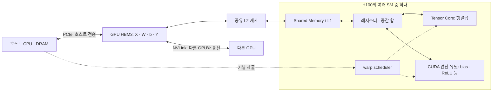
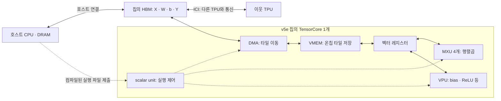
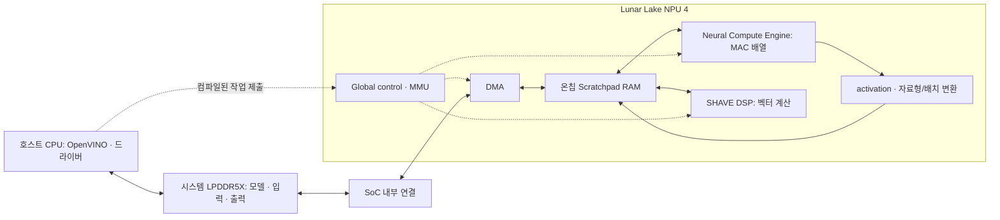

# 5주차 통합 문서: GPU·TPU·NPU 비교와 장치 실험

## ① 무엇을 비교할까: 칩·시스템·사용 목적

다음 → [② 하드웨어](#hardware)

제품명을 정하기 전에 질문을 정한다. “행렬곱 한 번이 얼마나 빠른가?”, “동시에 들어오는 요청을 몇 개 처리하는가?”, “노트북에서 한 요청에 얼마의 에너지를 쓰는가?”는 서로 다른 실험이다.

### 1. 이번 주의 조사 대상

| 제조사·제품·세대 | 비교할 연산 자원 | 실행 환경 | 확인 상태 |
|---|---|---|---|
| NVIDIA H100 **SXM**, Hopper | 전체 GPU 1개 사용을 가정. MIG 분할 여부는 실습 때 확인 | CPU 호스트가 있는 서버 | 문헌 조사. 서버 구성·실행 버전·성능은 아직 미측정 |
| Google TPU **v5e** | TPU 칩 1개 사용을 가정 | Cloud TPU 호스트와 가속기 | 문헌 조사. 실제 할당 slice·호스트·소프트웨어는 미확인 |
| Intel Core Ultra **9 288V**, Series 2 / Lunar Lake, Intel AI Boost NPU | 프로세서에 통합된 NPU 1개 | CPU·GPU·NPU를 포함한 개인 기기 | 문헌 조사. 노트북 모델·OS·드라이버·실행 성능은 미확인 |

제품·폼팩터는 [H100 사양](https://www.nvidia.com/en-us/data-center/h100/), [TPU v5e 문서](https://docs.cloud.google.com/tpu/docs/v5e), [288V 사양](https://www.intel.com/content/www/us/en/products/sku/240961/intel-core-ultra-9-processor-288v-12m-cache-up-to-5-10-ghz/specifications.html)을 기준으로 한다. 설치 버전 기록 항목은 [④](#software)에 있다.

NPU는 신경망 가속기를 가리키는 넓은 이름이고 TPU도 신경망용 가속기다. 여기서 GPU·TPU·NPU라는 세 열은 **세 제품 사례의 약칭**이다.

### 2. 칩 하나와 시스템 하나는 다르다

v5e 문서의 기본 시스템 표는 **칩당 HBM**, **호스트당 8칩**, **Pod당 256칩**을 구분한다. serving에는 1·4·8칩 slice 구성이 있다. [Google: v5e System architecture / Configurations](https://docs.cloud.google.com/tpu/docs/v5e)

장치별 peak를 더한 값은 집계된 이론값이다. 실제 처리량에는 분할 방식·통신·불균형·호스트 작업이 영향을 준다. 8개 장치의 시간을 8로 나누거나 처리량을 8로 나눠 단일 장치의 실측값으로 바꿀 수 없다.

### 3. 같은 질문 안에서 비교하기

| 비교 목적 | 맞출 조건 | 이 비교로 답할 수 없는 질문 |
|---|---|---|
| 같은 연산의 커널 | 식·shape·값·자료형·희소성·메모리 경계·완료 기준 | 다른 모델의 품질·서비스 처리량 |
| 같은 모델의 추론 | 가중치·입력·품질 목표·전처리·출력·배치·실행 범위 | 학습 수렴 시간 |
| 서비스 처리량 | 모델·품질·요청 분포·동시성·지연시간 제한·장치 수 | 한 요청의 최소 지연시간 |
| 개인 기기의 추론 | 품질·응답시간·전력 모드·기기 전체 에너지·열 상태 | 데이터센터의 확장 효율 |
| 학습 | 데이터·정밀도·optimizer·목표 품질까지의 step 수·통신 | 같은 제품의 추론 성능 |

### 4. 두 종류의 공정성

**커널 비교는 계산 조건을 고정한다.** 예를 들어 X·W가 BF16이고 FP32로 누산한 뒤 FP32 bias·ReLU·출력을 사용한다면, 입력 파일이 FP32라는 이유만으로 동등하다고 볼 수 없다. 이 정밀도 계약을 지원하는지부터 확인한다.

**모델·시스템 비교는 품질과 사용 조건을 고정한다.** 내부에서는 BF16·FP16·INT8 경로가 다를 수 있다. 양자화·장치 분담·호스트 전송에 따라 결과가 달라질 수 있다.

“A가 빠르다”를 다음처럼 바꿔 쓰면 검증할 수 있다.

> A 제품 1개, 해당 소프트웨어 버전, 배치 128, 지정한 정밀도와 오차 기준에서, 준비 실행 후 장치 상주 입력의 동기화된 호출 시간이 B보다 짧았다.

---

## ② 계산과 데이터 이동은 누가 맡을까?

[5주차 목차](#overview) · 이전 → [① 비교 단위](#comparison-scope) · 다음 → [③ 사양](#specifications)

실선은 데이터 경로, 점선은 제어 관계다.

### 1. NVIDIA H100 SXM: SM 안에 여러 역할이 있다

CUDA 커널의 thread block이 SM에 배치되고, scheduler가 실행 가능한 warp에 명령을 발행한다. Tensor Core는 SM 안의 행렬곱 장치다. bias·ReLU는 일반 연산 유닛에서 처리할 수 있다. 컴파일러나 라이브러리가 이를 같은 커널의 후처리로 합칠 수도 있다. [CUDA Programming Model](https://docs.nvidia.com/cuda/cuda-programming-guide/01-introduction/programming-model.html), [Scaling Book: GPU 구성과 TPU 대응](https://jax-ml.github.io/scaling-book/gpus/)

> **CTA(Cooperative Thread Array):** CUDA의 thread block을 가리킨다. CTA 안의 thread들은 공유 메모리와 동기화로 협력하며, 보통 하나의 SM에 배치된다. SM에는 자원 한도에 따라 여러 CTA가 동시에 상주할 수 있다.

---

> **H100에서 CTA 간 통신:** CTA는 기본적으로 서로의 공유 메모리를 직접 공유하지 않는다. 하지만 여러 CTA를 thread block cluster로 묶으면 분산 공유 메모리(Distributed Shared Memory)와 cluster 동기화로 통신할 수 있다. 클러스터 밖의 CTA와 데이터 교환은 보통 전역 메모리와 커널 간 동기화를 이용한다. [CUDA Programming Guide: Thread Block Clusters](https://docs.nvidia.com/cuda/cuda-programming-guide/04-special-topics/cooperative-groups.html#thread-block-clusters)

타일과 Shared Memory 사용은 커널·컴파일러가 결정하고 캐시는 하드웨어가 관리한다. H100의 TMA는 메모리 복사를 돕는다. **자동 캐시 재사용과 명시적으로 보관한 타일은 구분**한다. H100의 L1·Shared Memory 결합 용량 256 KB와 사용 가능한 Shared Memory 최대 228 KB/SM도 같은 값이 아니다. [Hopper Tuning Guide: TMA / Memory System](https://docs.nvidia.com/cuda/hopper-tuning-guide/index.html)

> **참고:** TMA(Tensor Memory Accelerator)는 전역 메모리와 Shared Memory 사이의 타일 전송을 비동기화해 계산과 데이터 이동을 겹치게 돕는다.

### 2. Google TPU v5e: TensorCore 안에 MXU·벡터·제어 장치가 있다

v5e는 칩당 TensorCore 하나와 MXU 네 개를 갖는다. [Google: v5e System architecture](https://docs.cloud.google.com/tpu/docs/v5e)

MXU가 행렬곱을, VPU가 원소별 계산을, scalar unit이 제어를 담당하는 구조다. 컴파일러가 타일 이동과 계산의 겹침을 계획한다. VMEM은 GPU L2와 달리 명시적인 작업 버퍼로 설명되며, 구체적인 배치는 XLA 또는 Pallas 프로그램에 달려 있다. [Scaling Book 2장: What Is a TPU?](https://jax-ml.github.io/scaling-book/tpus/)

> **참고:** DMA(Direct Memory Access)는 CPU가 데이터 하나하나를 복사하지 않고 메모리와 가속기 버퍼 사이의 전송을 수행한다. 전송 설정과 완료 동기화는 여전히 필요하다.

### 3. Intel Core Ultra 9 288V NPU: SoC 안의 추론 엔진

Intel의 NPU 4 자료에는 MAC 배열, activation·변환 파이프라인, SHAVE DSP, DMA, Scratchpad RAM이 구분되어 있다. 행렬곱은 MAC 배열, ReLU는 activation 경로 등으로 처리할 수 있다. [Intel Lunar Lake AI Hardware Accelerators, 슬라이드 25–35](https://cdrdv2-public.intel.com/824436/2024_Intel_Tech%20Tour%20TW_Lunar%20Lake%20AI%20Hardware%20Accelerators.pdf)

OpenVINO Python API에서는 사용자가 MAC 배열의 타일 배치나 하드웨어 동작을 직접 지정하는 대신, 모델을 컴파일하고 추론을 요청한다. 연산 배치와 메모리 이동은 NPU 컴파일러가 최적화한다. [OpenVINO 2026: NPU Device 도입부](https://docs.openvino.ai/2026/openvino-workflow/running-inference/inference-devices-and-modes/npu-device.html)

>MAC(Multiply-Accumulate)은 곱셈 결과를 누산하는 연산이다. MAC 배열은 이런 연산을 병렬로 수행해 행렬곱 등을 처리한다.

### 4. Tiling 관점에서 본다면

| 질문 | H100 SXM | TPU v5e | 288V NPU |
|---|---|---|---|
| 큰 텐서가 있는 메모리 | HBM | HBM | 공유 시스템 메모리 |
| 가까운 데이터 재사용 공간 | 캐시·Shared Memory·레지스터 | VMEM·벡터 레지스터 | Scratchpad·엔진 내부 저장 공간 |
| 이동과 실행을 누가 계획하는가? | 커널·컴파일러·라이브러리와 하드웨어 scheduler/캐시 | XLA/Pallas와 DMA·제어 장치 | NPU 컴파일러와 런타임·DMA·제어 장치 |
| 이번에 확인할 것 | 타일·fusion·캐시 hit·spill | 타일·padding·VMEM 사용·fusion | 컴파일 지원·배치·변환·실제 장치 실행 |

---

## ③ 성능표의 숫자는 어떤 조건의 값일까?

[5주차 목차](#overview) · 이전 → [② 하드웨어](#hardware) · 다음 → [④ 소프트웨어](#software)

### 1. 공시 연산 성능

| 대상·집계 범위 | 표기값 | 읽어야 할 조건 | 아직 연결할 수 없는 값 |
|---|---|---|---|
| H100 SXM GPU 1개, BF16 Tensor Core | **약 990 TFLOP/s (추산)** | sparsity 적용 공시값 1,979를 절반으로 환산 | dense `XW`의 실제 처리율 |
| H100 SXM GPU 1개, INT8 Tensor Core | **약 1,979 TOPS (추산)** | sparsity 적용 공시값 3,958을 절반으로 환산. BF16과 자료형이 다름 | BF16 커널의 실행시간 |
| TPU v5e 칩 1개, BF16 | **197 TFLOP/s** | 칩당 peak. 사양 표에 별도 sparse 배수 각주 없음 | 특정 shape의 실제 MXU 이용률 |
| TPU v5e 칩 1개, INT8 | **393 TOPS** | 정수 연산 peak. BF16 행과 분리 | 양자화·변환을 포함한 추론 시간 |
| Core Ultra 9 288V의 NPU | **48 TOPS, INT8** | NPU 항목. `Sparsity Support: Yes`는 별도 항목 | 사양 페이지에서 48의 dense/sparse 조건·누산은 이번 조사에서 미확인 |
| Core Ultra 9 288V 전체 | **120 TOPS, INT8** | NPU만의 값이 아닌 프로세서 전체 항목 | 한 그래프가 이 처리율을 달성한다는 보장 |

출처: [NVIDIA H100 Product Specifications의 **SXM 열과 각주**][specifications-h100], [Google TPU v5e System architecture][specifications-v5e], [Intel 288V Essentials / NPU Specifications][specifications-intel].

> **추산값 안내:** H100의 표 값은 구조화된 sparsity 적용 공시 peak를 절반으로 나눈 dense 대응 추정치다. 실측 성능이나 보장값은 아니며, 조건에 맞는 희소성 형식과 실행 경로가 필요하다. 임의의 0이 많은 행렬에 그대로 적용되는 값이 아니다. [NVIDIA Hopper Architecture의 sparsity 설명][specifications-hopper]

### 2. 입력·계산·누산·출력은 각각 적는다

| 예시 경로 | 입력·가중치 | 곱셈·누산 | bias·출력 | 확인할 조건 |
|---|---|---|---|---|
| 공통 커널 비교 계약 | BF16 | BF16 곱셈 / FP32 누산 | FP32 | 이 계약을 실제로 지킨 구현끼리 비교 |
| H100 Tensor Core 구현 후보 | BF16 | BF16 / FP32를 선택하고 생성 코드로 확인 | FP32를 유지하도록 구현 | 사양의 BF16 peak만으로 구현을 확인할 수 없음 |
| v5e MXU 구현 후보 | BF16 | BF16 / FP32 경로. JAX의 반환 dtype·정밀도 설정도 확인 | FP32를 유지하도록 구현 | 출력 dtype만으로 내부 알고리즘을 단정하지 않음 |
| OpenVINO NPU 비양자화 경로 | 모델에 FP32/F16 표현 가능 | 문서는 HW 계산 FP16 명시. 실제 누산은 이번 조사에서 미확인 | 그래프·변환·실행 결과 확인 | FP32 모델 입력을 FP32 하드웨어 계산으로 해석하지 않음 |

### 3. 메모리와 연결 대역폭

| 항목 | H100 SXM 1개 | TPU v5e 1칩 | 288V NPU 1개 |
|---|---|---|---|
| 큰 메모리 | 80 GB HBM3 | 16 GB HBM, 공식 표기 유지 | 프로세서 사양 최대 32 GB LPDDR5X. NPU 전용 용량이 아님 |
| 큰 메모리 대역폭 | 3.35 TB/s | **800 GiB/s**, 확인한 공식 문서 표기 | NPU가 지속적으로 쓸 수 있는 유효 대역폭은 아직 미측정 |
| 온칩 저장 공간 | H100 L2 50 MB, Shared Memory·레지스터 | VMEM·벡터 레지스터. v5e의 상세 용량은 이번 조사에서 미확인 | Scratchpad 등. 해당 SKU의 상세 용량은 이번 조사에서 미확인 |
| 가속기 간 연결 | NVLink 900 GB/s, 양방향 합계 | ICI 400 GB/s/칩, 양방향 합계 | 이번 단일 NPU 과제에서 해당 없음 |
| 호스트 연결 | PCIe Gen5 128 GB/s, 양방향 합계 | 호스트 연결의 해당 구성별 대역폭은 이번 조사에서 미확인 | SoC 내부 연결·공유 메모리. GPU의 PCIe 전송 모델과 구분 |

출처: [H100 제품 표][specifications-h100], [Hopper Tuning Guide의 L2 / NVLink][specifications-tuning], [Hopper Architecture의 PCIe 설명][specifications-hopper], [v5e 표][specifications-v5e], [Intel 메모리 사양][specifications-intel], [NPU 4 구조 자료][specifications-npu4]. 상세 메모리 구조는 [②](#hardware)를 참고한다.

- `1 TB/s = 10¹² Byte/s`, `1 GiB/s = 2³⁰ Byte/s`다. 위 v5e 값은 계산하면 약 **858.99 GB/s**다. Scaling Book은 `8.2×10¹¹ Byte/s` 표기

### 4. 전력 사양을 읽는 법

H100 SXM의 최대 TDP는 설정 가능한 **최대 700 W**다. 288V의 **Processor Base Power 30 W / Maximum Turbo Power 37 W**는 프로세서 전력 항목이며 NPU 단독의 측정 전력이 아니다. v5e의 칩 전력은 이번에 확인한 사양 표에서 확인하지 못했다. [H100][specifications-h100], [Intel 288V][specifications-intel]

같은 품질·부하·측정 경계에서 J/request 또는 J/sample 구할 수 있다. 계산 방법은 [⑤](#measurement)에 있다.

> **참고:** TDP(Thermal Design Power)는 열·전력 설계를 위한 제품 사양이지, 작업 중 실제 소비전력이나 에너지 측정값은 아니다. 제품마다 전력 항목의 정의와 범위도 다를 수 있다.

[specifications-h100]: https://www.nvidia.com/en-us/data-center/h100/
[specifications-v5e]: https://docs.cloud.google.com/tpu/docs/v5e
[specifications-intel]: https://www.intel.com/content/www/us/en/products/sku/240961/intel-core-ultra-9-processor-288v-12m-cache-up-to-5-10-ghz/specifications.html
[specifications-hopper]: https://developer.nvidia.com/blog/nvidia-hopper-architecture-in-depth/
[specifications-tuning]: https://docs.nvidia.com/cuda/hopper-tuning-guide/index.html
[specifications-triton]: https://triton-lang.org/main/getting-started/tutorials/03-matrix-multiplication.html
[specifications-tpus]: https://jax-ml.github.io/scaling-book/tpus/
[specifications-jax-dot]: https://docs.jax.dev/en/latest/_autosummary/jax.lax.dot.html
[specifications-npu]: https://docs.openvino.ai/2026/openvino-workflow/running-inference/inference-devices-and-modes/npu-device.html
[specifications-npu4]: https://cdrdv2-public.intel.com/824436/2024_Intel_Tech%20Tour%20TW_Lunar%20Lake%20AI%20Hardware%20Accelerators.pdf

---

## ④ 같은 모델에서 장치 실행까지

[5주차 목차](#overview) · 이전 → [③ 사양](#specifications) · 다음 → [⑤ 측정](#measurement)

### 1. 세 실행 경로

| 대상 | 모델 수준의 경로 | 직접 커널을 다룰 때 | 지원·실행 확인 항목 |
|---|---|---|---|
| NVIDIA H100 SXM | 프레임워크 그래프 → GPU 라이브러리 또는 생성된 커널 → CUDA 실행 | CUDA에서는 thread/block·메모리·동기화, Triton에서는 블록 단위 계산·타일·입출력 경계를 표현 | 프레임워크의 실제 실행 로그, 생성 코드, CUDA 대상 아키텍처, 라이브러리·Triton의 연산과 dtype 조건 |
| Google TPU v5e | JAX 함수 → 추적·jaxpr → XLA 컴파일 → TPU 실행 | Pallas로 블록·메모리 접근·커널 계산을 작성하고 TPU backend로 컴파일 | JAX/XLA lowering 오류, shape·dtype, Pallas TPU 지원 범위, jax/jaxlib/libtpu 조합 |
| Intel 288V NPU | 모델 변환·읽기 → OpenVINO 그래프 → NPU plugin·compiler → 드라이버·NPU | 경로는 모델 컴파일 API. CUDA/Triton 커널을 NPU에 그대로 넘기는 경로가 아님 | 장치 인식, `query_model`, NPU 대상 컴파일 로그, 실행·출력 검증 |

근거: [CUDA Programming Model][software-cuda], [Triton MatMul][software-triton], [JAX JIT][software-jax-jit], [Pallas TPU MatMul][software-pallas], [OpenVINO NPU][software-npu], [OpenVINO Core API][software-ov-core].

커널을 직접 작성하면 타일 재사용과 fusion을 제어할 여지가 생기지만, 프레임워크의 기존 최적화보다 항상 빠른 것은 아니다. `matmul → add → relu` 그래프가 있다고 해서 하나의 fused 커널이 올바르게 생성되었다고 볼 수 없다. 실제로는 실행 파일이나 프로파일에서 확인해야 한다.

### 2. NVIDIA: host와 device의 역할

호스트는 메모리를 준비하고 GPU 작업을 제출한다. CUDA 커널은 thread block들로 실행된다. 라이브러리에 MatMul을 맡길 수도 있고 Triton으로 행렬곱과 bias·ReLU를 함께 계산할 수도 있다. [CUDA][software-cuda], [Triton][software-triton]

이번 strict 커널 조건에서는 X·W를 BF16, 누산·bias·ReLU·Y를 FP32로 유지한다. MatMul 결과를 BF16으로 먼저 저장한 뒤 FP32 bias를 더하면 **중간 반올림이 추가된다.**

GPU 커널 제출은 비동기일 수 있다. 호스트 함수가 돌아온 시점만 재면 실행 완료 시간이 아니다. 장치 event 또는 명시적인 완료 대기가 필요하다. [CUDA: Asynchronous Execution][software-cuda-async]

> **참고:** FP32 결과를 BF16으로 변환해 저장할 때 BF16으로 표현 가능한 값으로 반올림되며, 이후 FP32로 변환해도 버려진 정밀도는 복원되지 않는다.

### 3. TPU: JIT 컴파일과 정밀도를 구분한다

`jax.jit`의 첫 실행에는 추적·컴파일이 포함될 수 있고, 같은 조건의 다음 호출은 컴파일된 코드를 재사용한다. [JAX JIT][software-jax-jit]

JAX의 dot 연산은 `precision`과 `preferred_element_type`을 구분한다. 후자는 출력 dtype을 지정하며, 알고리즘을 별도로 지정하지 않은 경우 누산 dtype에 대한 **컴파일러 힌트**이기도 하다. BF16 입력과 FP32 출력 설정, 컴파일 산출물, 오차를 함께 확인한다. [JAX dot API][software-jax-dot]

Pallas는 이보다 낮은 수준에서 블록과 커널을 표현한다. TPU 타일의 배수 제약·padding·경계 처리를 확인해야 하므로, 배치 128용 커널을 배치 1에 그대로 적용하지 않는다. [Pallas TPU MatMul][software-pallas]

[software-cuda]: https://docs.nvidia.com/cuda/cuda-programming-guide/01-introduction/programming-model.html
[software-cuda-async]: https://docs.nvidia.com/cuda/cuda-programming-guide/02-basics/asynchronous-execution.html
[software-triton]: https://triton-lang.org/main/getting-started/tutorials/03-matrix-multiplication.html
[software-jax-jit]: https://docs.jax.dev/en/latest/jit-compilation.html
[software-jax-dot]: https://docs.jax.dev/en/latest/_autosummary/jax.lax.dot.html
[software-pallas]: https://docs.jax.dev/en/latest/pallas/tpu/matmul.html
[software-npu]: https://docs.openvino.ai/2026/openvino-workflow/running-inference/inference-devices-and-modes/npu-device.html

[software-ov-core]: https://docs.openvino.ai/2026/api/ie_python_api/_autosummary/openvino.Core.html

---

## ⑤ 실제로 빠르다는 뜻: 무엇의 시간을 재었을까?

[5주차 목차](#overview) · 이전 → [④ 소프트웨어](#software) · 다음 → [⑥ 조건표·계산](#comparison-exercise)

### 1. 시간의 시작과 끝

직렬 경로를 보여주는 그림이다. 비동기 서비스에서는 전송·계산·다른 요청이 겹칠 수 있다.

GPU event로 얻은 시간과 JAX `block_until_ready()`를 포함한 호스트 시간을 바로 비교하지 않는다. NPU에 동등한 장치 타이머가 없다면 세 장치 모두 **동기화된 호출 시간**이나 **전체 요청 시간**처럼 공통으로 구현 가능한 범위로 맞춘다.

### 2. 배치 지연시간과 처리량

이 과제에서 X의 **한 행을 sample 하나**, M행의 호출을 **batch 하나**로 정의한다.

즉, `X`의 shape이 `[M, K]`라면 각 행은 특성 K개를 가진 입력 하나다. `XW+b`는 각 행에 같은 가중치 `W`와 bias `b`를 적용해 대응하는 출력 행을 만든다. 따라서 한 번의 호출에서 M개 입력을 함께 처리하며 batch size는 M이다. `M=1`이면 1-sample batch, `M=128`이면 128-sample batch다.

$$
\text{batch latency}=t_M\ [\mathrm{ms/batch}],\qquad
\text{samples/s}=\frac{R\times M}{T\ [\mathrm{s}]}
$$

- R: 측정 구간에 완료한 **호출 수**
- M: 배치

| 배치 | 지연시간 기록 | 처리량 기록 | 해석할 때 주의할 점 |
|---|---|---|---|
| M=1 | ms / 1-sample batch, p50·p95 등 | samples/s, 요청 하나=한 행이면 requests/s도 가능 | 작은 작업은 제출·동기화 비용이 지배할 수 있음 |
| M=128 | ms / 128-sample batch, p50·p95 등 | samples/s와 batches/s를 구분 | `t₁₂₈ / 128`은 분담된 시간이며 한 요청이 기다린 시간이 아님 |

### 3. 전력과 sample당 에너지

$$
E=\int_{t_0}^{t_1}P(t)\,dt\ [\mathrm{J}],\qquad
E_{\mathrm{sample}}=\frac{E}{\text{완료한 sample 수}}
$$

전력은 단위 시간당 에너지이므로 `P(t)=dE/dt`다. 아주 짧은 시간 `dt` 동안 소비한 에너지는 `dE=P(t)dt`이고, 이를 측정 시작 `t₀`부터 끝 `t₁`까지 누적하면 `E=∫[t₀,t₁]P(t)dt`가 된다. 여기서 J(줄, joule)는 에너지의 SI 단위다.

실제 계측에서는 시간 간격 `Δt`마다 전력을 읽어 `E≈ΣᵢPᵢΔt`로 근사한다. 얻은 에너지를 같은 측정 구간에 완료한 sample 수로 나누면 sample 하나당 에너지(J/sample)가 된다.

예를 들어 평균 100 W로 2초 동안 실행해 sample 200개를 완료했다면 `E=100×2=200 J`, 즉 `E_sample=200/200=1 J/sample`이다.

---

## ⑥ 벤치마크 대상 커널

[5주차 목차](#overview) · 이전 → [⑤ 측정](#measurement) · [제출용 양식](#comparison-template)

$$
Y=\operatorname{ReLU}(XW+b),\quad
X\in\mathbb{R}^{M\times1024},\quad
W\in\mathbb{R}^{1024\times1024},\quad
b\in\mathbb{R}^{1024},\quad M\in\{1,128\}
$$

b는 모든 행에 broadcast한다. 추론만 수행하며 학습·gradient·optimizer는 없다. 아래의 **설계 조건**, **문헌 확인**, **계산**, **아직 미측정**을 구분한다.
